# Модуль 2. Пример решения — через конструктор phpMyAdmin

Цель задания — создать базу и таблицы по своей ER-диаграмме в phpMyAdmin, настроить ключи и импортировать `Заказчики.json`.

---

## 1. Запуск XAMPP и открытие phpMyAdmin

1. Запустите **XAMPP Control Panel**.

   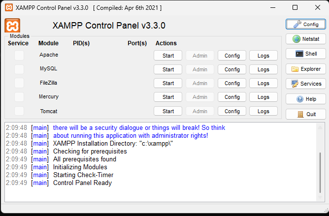

   /// caption
   Рисунок 1 – Открытие XAMPP Control Panel
   ///

2. Нажмите **Start** в строке **Apache** → дождитесь статуса **Running**.

   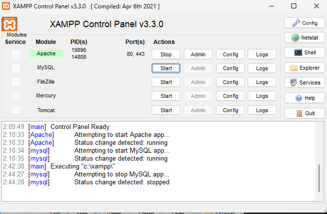

   /// caption
   Рисунок 2 – Запуск Apache
   ///

3. Нажмите **Start** в строке **MySQL** → дождитесь статуса **Running**.

   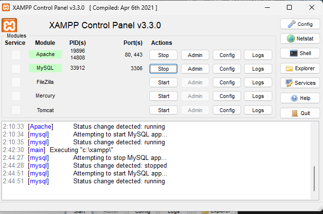

   /// caption
   Рисунок 3 – Запуск MySQL
   ///

4. Откройте phpMyAdmin:

   **Вариант A:** кнопка **Admin** в строке MySQL.

   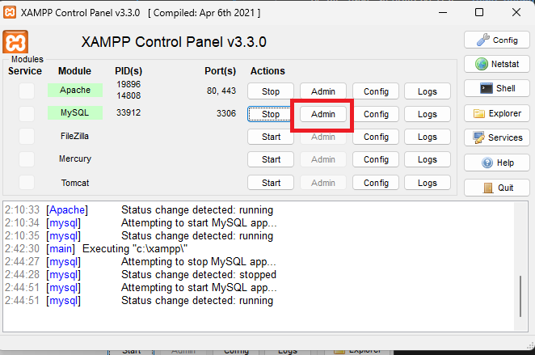

   /// caption
   Рисунок 4 – Открытие через кнопку Admin
   ///

   **Вариант B:** в браузере `http://localhost/phpmyadmin/`

   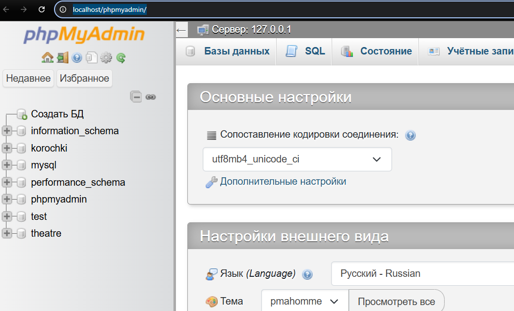

   /// caption
   Рисунок 5 – Открытие через браузер
   ///

5. Убедитесь, что phpMyAdmin открылся без ошибок.

   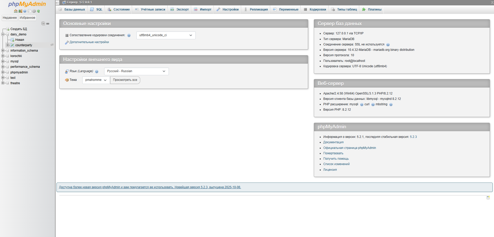

   /// caption
   Рисунок 6 – Главная страница phpMyAdmin
   ///

---

## 2. Создание базы данных

1. Нажмите **Создать БД** (**New**) в левой панели. В поле **Имя базы данных** введите `dairy_demo`.
2. В списке **Сравнение** (**Collation**) выберите `utf8mb4_unicode_ci`.
3. Нажмите **Создать** (**Create**).

   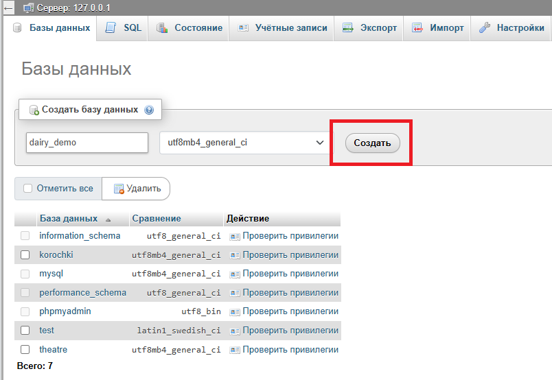

   /// caption
   Рисунок 7 – Создание базы данных `dairy_demo`
   ///

4. БД `dairy_demo` появится в левой панели.

   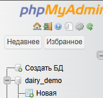

   /// caption
   Рисунок 8 – База данных в дереве phpMyAdmin
   ///

---

## Настройки конструктора таблиц

1. Откройте `dairy_demo` и вкладку **Структура** (**Structure**). В блоке **Создать новую таблицу** укажите её имя и количество полей. Нажмите **Создать** или **Вперёд**.
2. Заполните **Имя**, **Тип** и **Длина/Значения**. Например, для `DECIMAL(12,3)` выберите тип `DECIMAL` и введите `12,3` в **Длина/Значения**. Для `BIGINT` оставьте длину пустой.
3. Для `id` во всех 12 таблицах отметьте **A_I** (**AUTO_INCREMENT**) и проверьте, что в **Индекс** выбрано **PRIMARY**. База выдаёт номер при добавлении новой записи, а ключ гарантирует уникальность.
4. Если таблица разрешает пустое значение, поставьте флажок **Null** и в поле **По умолчанию** выберите **NULL**. Для числового значения по умолчанию выберите **Как определено** и впишите число. У обязательных полей флажок **Null** оставьте пустым.
5. Убедитесь, что в **Тип таблиц** выбран **InnoDB**. Сравнение можно оставить пустым, чтобы таблица унаследовала `utf8mb4_unicode_ci` от базы. Нажмите **Сохранить** и сверьте поля на вкладке **Структура**.

---

## Создайте таблицу counterparty

Имя таблицы: `counterparty`, количество столбцов: **7**.

| Field | Type | Length | Null | Default | Index | Extra |
|-------|------|--------|------|---------|-------|-------|
| id | BIGINT | | NO | | PRIMARY | AUTO_INCREMENT |
| name | VARCHAR | 255 | NO | | | |
| inn | VARCHAR | 32 | YES | NULL | | |
| address | VARCHAR | 255 | YES | NULL | | |
| phone | VARCHAR | 64 | YES | NULL | | |
| is_salesman | TINYINT | 1 | NO | 0 | | |
| is_buyer | TINYINT | 1 | NO | 0 | | |

- Engine: **InnoDB**, Collation: `utf8mb4_unicode_ci`

   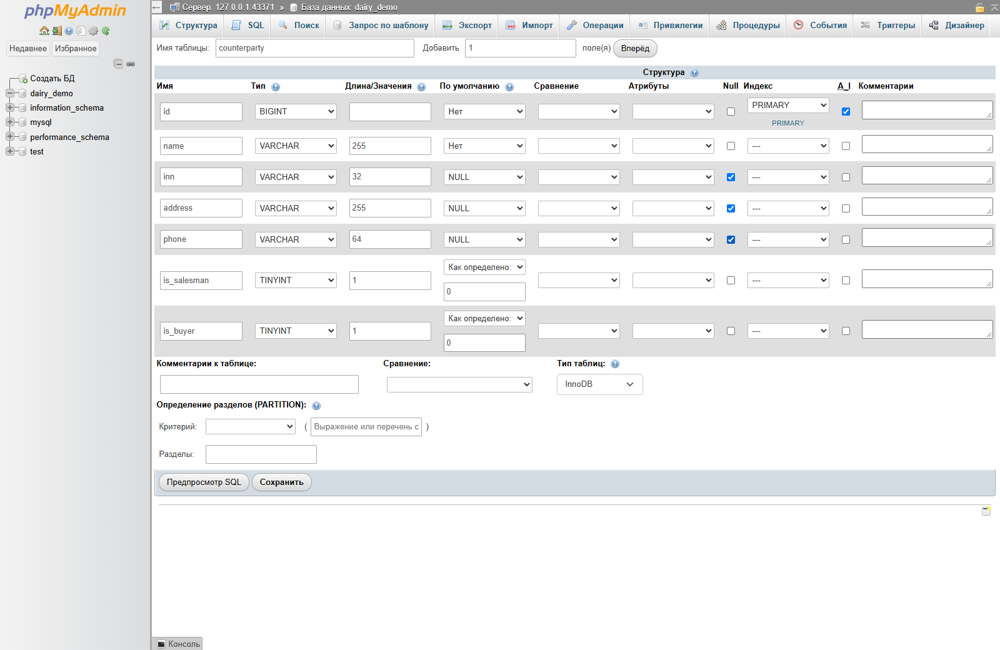

   /// caption
   Рисунок 9 – Задание имени и структуры таблицы
   ///

После сохранения откройте вкладку **Структура**. У `id` должны быть первичный ключ и `AUTO_INCREMENT`. Сверьте типы `inn`, `address` и `phone` с таблицей выше. Для всех трёх нужен `VARCHAR`.

---

## Создайте таблицу item

Имя: `item`, столбцов: **5**.

| Field | Type | Length | Null | Default | Index | Extra |
|-------|------|--------|------|---------|-------|-------|
| id | BIGINT | | NO | | PRIMARY | AUTO_INCREMENT |
| code | VARCHAR | 64 | YES | NULL | UNIQUE | |
| name | VARCHAR | 255 | NO | | | |
| item_type | ENUM('product','material') | | NO | | | |
| unit_default | VARCHAR | 32 | YES | NULL | | |

Для `item_type` выберите **ENUM** и в поле **Длина/Значения** введите `'product','material'`. Для `code` в столбце **Индекс** выберите **UNIQUE**, в окне индекса введите `uq_item_code`, оставьте столбец `code` и нажмите **Вперёд**. Сохраните таблицу и проверьте индекс в разделе **Индексы** на вкладке **Структура**.

   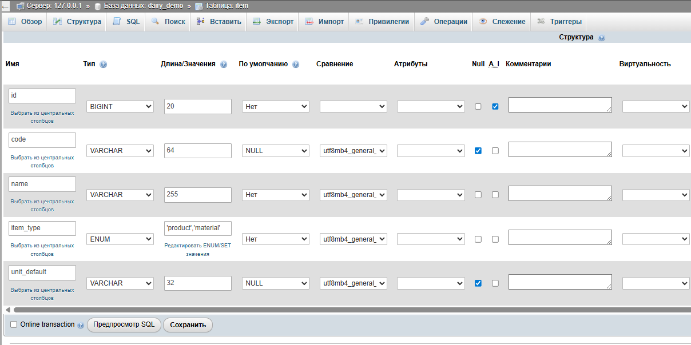

   /// caption
   Рисунок 12 – Таблица `item`
   ///

---

## Создайте таблицу price

Имя: `price`, столбцов: **5**.

| Field | Type | Length | Null | Default |
|-------|------|--------|------|---------|
| id | BIGINT | | NO | AUTO_INCREMENT, PK |
| item_id | BIGINT | | NO | |
| price | DECIMAL | 12,2 | NO | |
| effective_from | DATE | | YES | NULL |
| effective_to | DATE | | YES | NULL |

FK: `item_id` → `item(id)` ON UPDATE CASCADE ON DELETE RESTRICT

   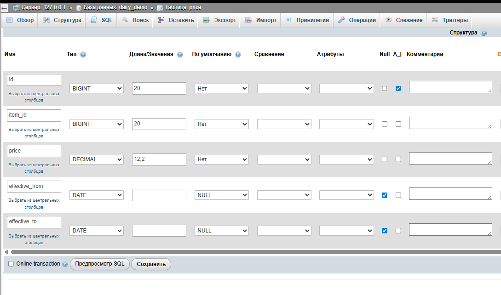

   /// caption
   Рисунок 13 – Таблица `price`
   ///

---

## Создайте таблицу specification

Имя: `specification`, столбцов: **6**.

| Field | Type | Null | Default |
|-------|------|------|---------|
| id | BIGINT AUTO_INCREMENT PK | NO | |
| name | VARCHAR(255) | NO | |
| product_item_id | BIGINT FK→item | NO | |
| output_qty | DECIMAL(12,3) | NO | 1.000 |
| output_unit | VARCHAR(32) | YES | NULL |
| manufacturer_id | BIGINT FK→counterparty | YES | NULL |

   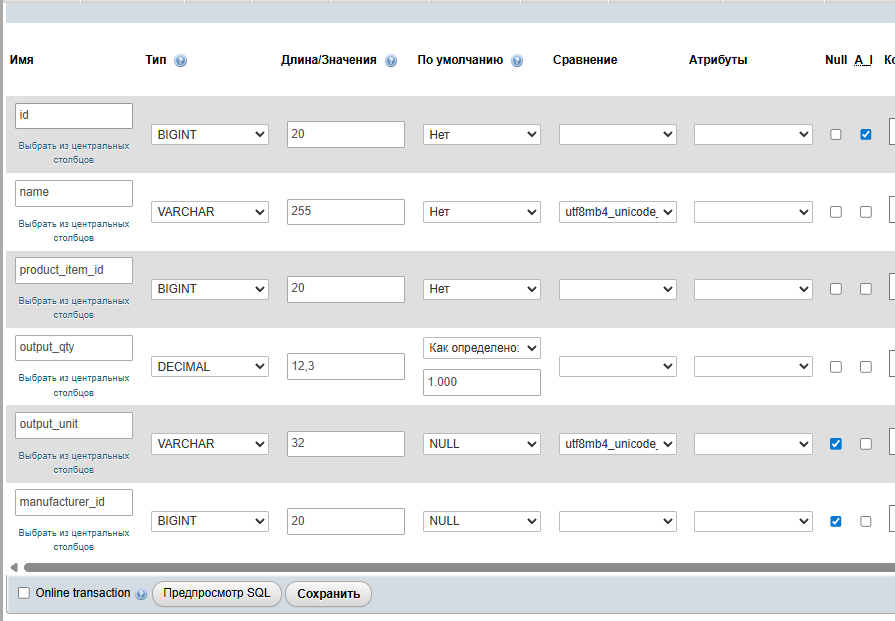

   /// caption
   Рисунок 14 – Таблица `specification`
   ///

## Создайте таблицу specification_material

Имя: `specification_material`, столбцов: **5**.

| Field | Type | Null |
|-------|------|------|
| id | BIGINT AUTO_INCREMENT PK | NO |
| specification_id | BIGINT FK→specification | NO |
| material_item_id | BIGINT FK→item | NO |
| qty | DECIMAL(12,3) | NO |
| unit | VARCHAR(32) | YES |

Чтобы один материал вносился в спецификацию только один раз, добавьте составной индекс `(specification_id, material_item_id)`. На вкладке **Структура** в блоке **Индексы** укажите **Создать индекс для 2 столбцов** и нажмите **Вперёд**. В окне **Добавить индекс** введите `uq_spec_material`, выберите **UNIQUE** и укажите в первой строке `specification_id`, во второй — `material_item_id`. Оба поля **Размер** оставьте пустыми. Нажмите **Вперёд**.

   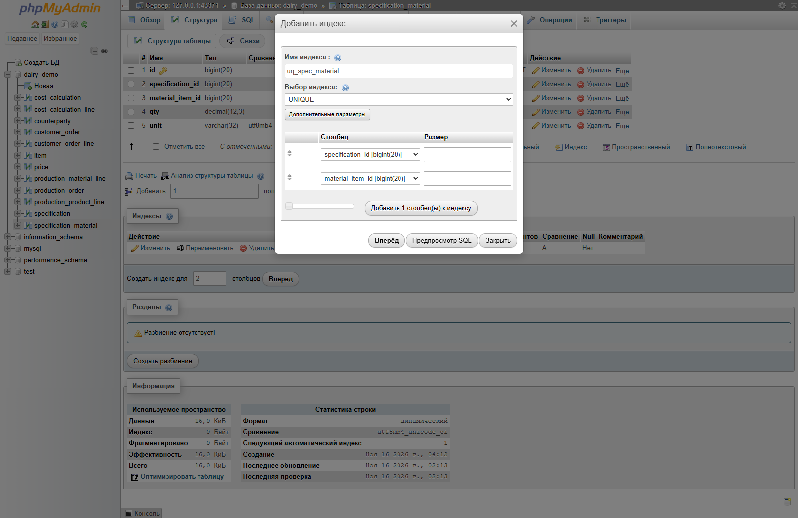

   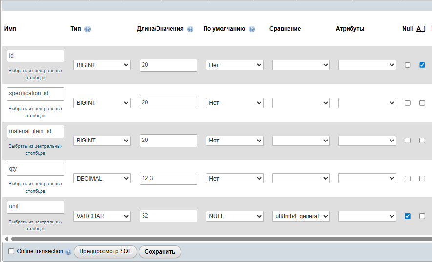

   /// caption
   Рисунок 15 – Таблица `specification_material`
   ///

---

## Создайте таблицу production_order

Имя: `production_order`, столбцов: **5**.

| Имя | Тип | Null |
|---|---|---|
| id | BIGINT(20) | ☐ |
| doc_no | VARCHAR(64) | ☐ |
| doc_date | DATE | ☑ |
| manufacturer_id | BIGINT(20) | ☑ |
| note | TEXT | ☑ |

   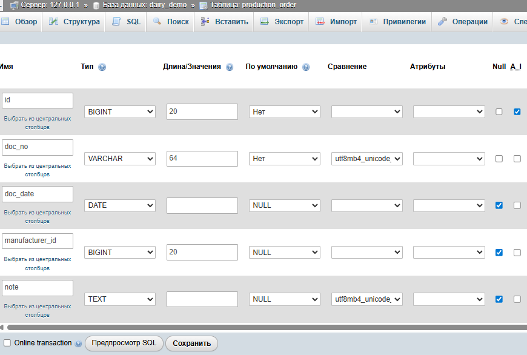

   /// caption
   Рисунок 16 – Таблица `production_order`
   ///

## Создайте таблицу production_product_line

Имя: `production_product_line`, столбцов: **5**.

| Имя | Тип | Null |
|---|---|---|
| id | BIGINT(20) | ☐ |
| production_order_id | BIGINT(20) | ☐ |
| product_item_id | BIGINT(20) | ☐ |
| qty | DECIMAL(12,3) | ☐ |
| unit | VARCHAR(32) | ☑ |

   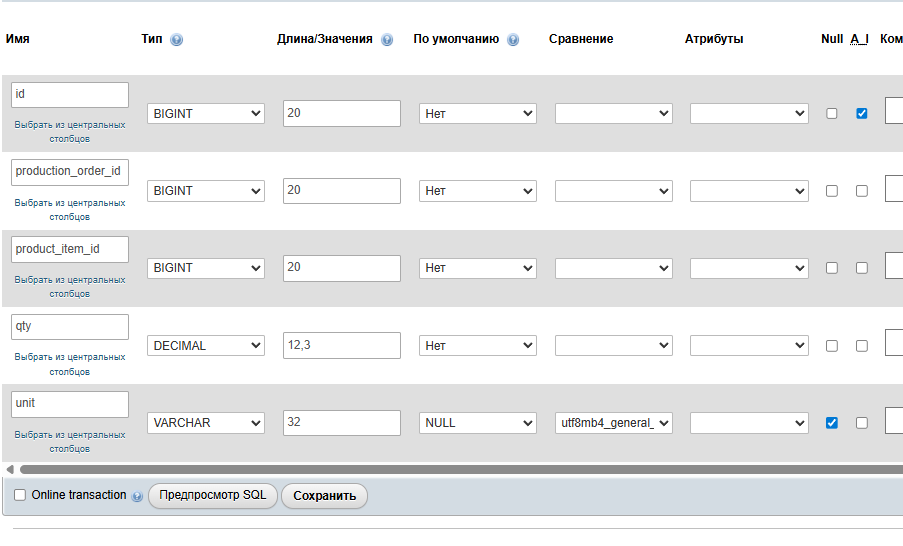

   /// caption
   Рисунок 17 – Таблица `production_product_line`
   ///

## Создайте таблицу production_material_line

Имя: `production_material_line`, столбцов: **5**.

| Имя | Тип | Null |
|---|---|---|
| id | BIGINT(20) | ☐ |
| production_order_id | BIGINT(20) | ☐ |
| material_item_id | BIGINT(20) | ☐ |
| qty | DECIMAL(12,3) | ☐ |
| unit | VARCHAR(32) | ☑ |

   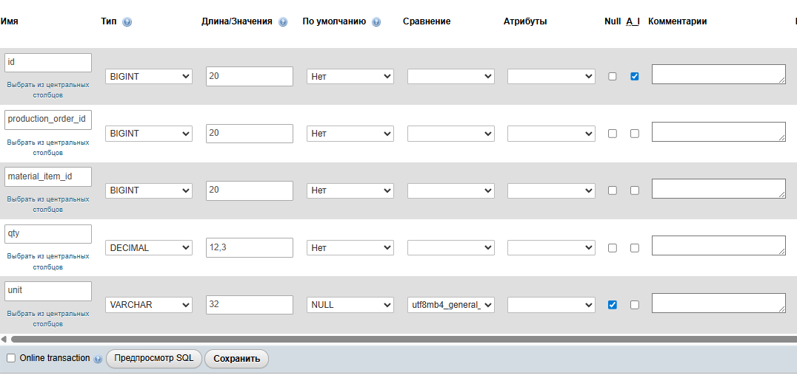

   /// caption
   Рисунок 18 – Таблица `production_material_line`
   ///

---

## Создайте таблицу customer_order

Имя: `customer_order`, столбцов: **6**.

| Имя | Тип | Null |
|---|---|---|
| id | BIGINT(20) | ☐ |
| doc_no | VARCHAR(64) | ☐ |
| doc_date | DATE | ☑ |
| executor_id | BIGINT(20) | ☑ |
| customer_id | BIGINT(20) | ☑ |
| total_amount | DECIMAL(12,2) | ☑ |

   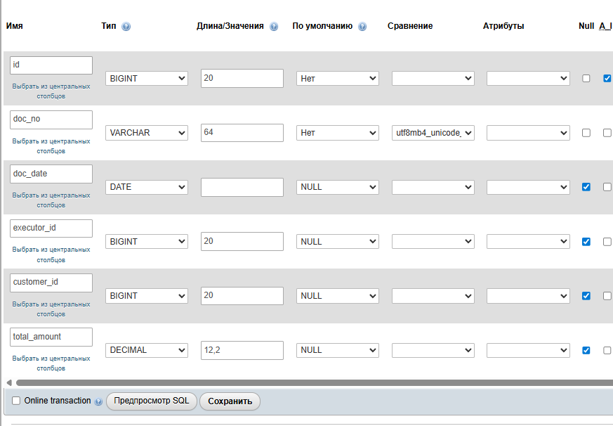

   /// caption
   Рисунок 19 – Таблица `customer_order`
   ///

## Создайте таблицу customer_order_line

Имя: `customer_order_line`, столбцов: **7**.

| Имя | Тип | Null |
|---|---|---|
| id | BIGINT(20) | ☐ |
| customer_order_id | BIGINT(20) | ☐ |
| product_item_id | BIGINT(20) | ☐ |
| qty | DECIMAL(12,3) | ☐ |
| unit | VARCHAR(32) | ☑ |
| unit_price | DECIMAL(12,2) | ☑ |
| line_amount | DECIMAL(12,2) | ☑ |

   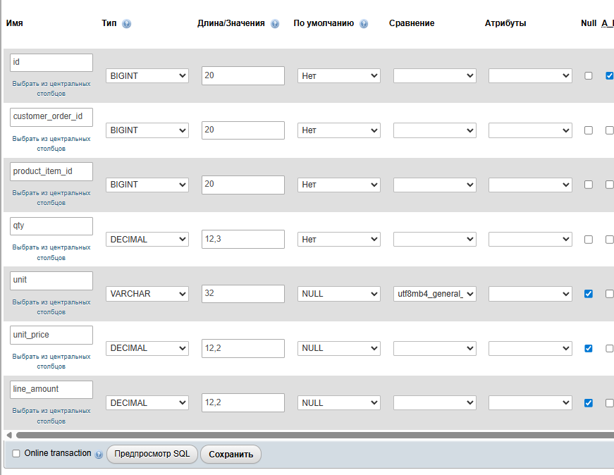

   /// caption
   Рисунок 20 – Таблица `customer_order_line`
   ///

---

## Создайте таблицу cost_calculation

Имя: `cost_calculation`, столбцов: **5**. Для `product_qty` задайте значение по умолчанию `1.000`.

| Имя | Тип | Null |
|---|---|---|
| id | BIGINT(20) | ☐ |
| calc_date | DATE | ☑ |
| product_item_id | BIGINT(20) | ☐ |
| product_qty | DECIMAL(12,3) | ☐ |
| total_cost | DECIMAL(12,2) | ☑ |

   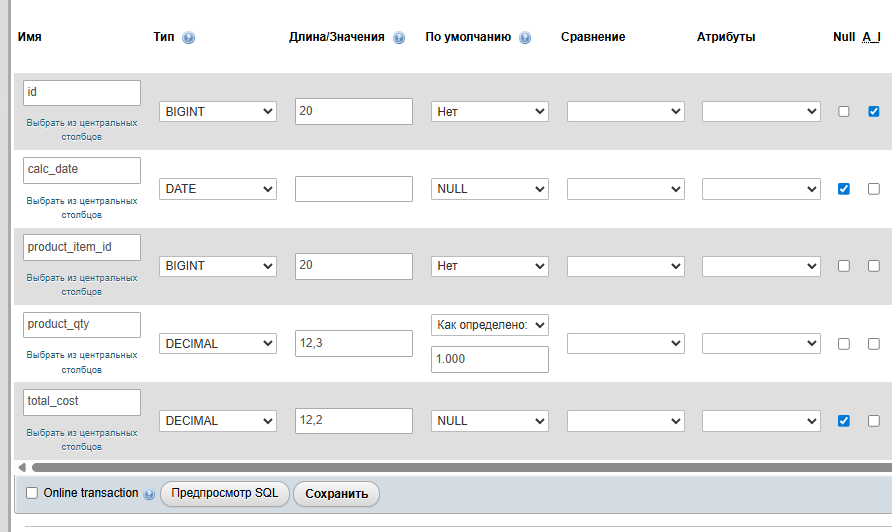

   /// caption
   Рисунок 21 – Таблица `cost_calculation`
   ///

## Создайте таблицу cost_calculation_line

Имя: `cost_calculation_line`, столбцов: **7**.

| Имя | Тип | Null |
|---|---|---|
| id | BIGINT(20) | ☐ |
| cost_calculation_id | BIGINT(20) | ☐ |
| material_item_id | BIGINT(20) | ☐ |
| qty | DECIMAL(12,3) | ☐ |
| unit | VARCHAR(32) | ☑ |
| unit_cost | DECIMAL(12,2) | ☑ |
| line_cost | DECIMAL(12,2) | ☑ |

   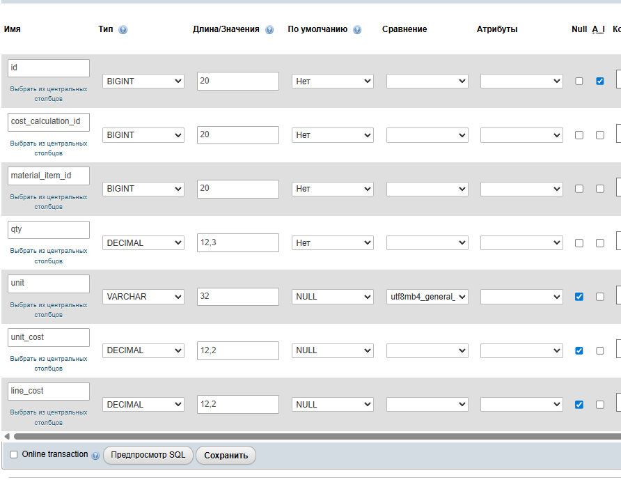

   /// caption
   Рисунок 22 – Таблица `cost_calculation_line`
   ///

---

## 4. Настройка внешних ключей (Relation view)

Создавайте связи после того, как сохранены все 12 таблиц. Откройте таблицу, в которой находится внешний ключ, затем **Структура → Связи** (**Structure → Relation view**).

1. Введите имя ограничения в блоке **Ограничения внешнего ключа**. Для `price.item_id` используйте `fk_price_item`.
2. В левом столбце **Столбец** укажите `item_id`. Справа выберите базу `dairy_demo`, таблицу `item` и её столбец `id`. Список столбцов справа появится после выбора таблицы.
3. Для всех связей укажите **ON UPDATE → CASCADE**. Для **ON DELETE** используйте действие из таблицы ниже. `CASCADE` удаляет строки документа вместе с его шапкой. `RESTRICT` защищает общую запись справочника, пока на неё кто-то ссылается.
4. Если у таблицы два разных внешних ключа, нажмите **+ Добавить ограничение**. Кнопка **+ Добавить столбец** добавляет поле в тот же ключ. После заполнения нажмите **Сохранить** и сверьте, что оба ограничения сохранились.

   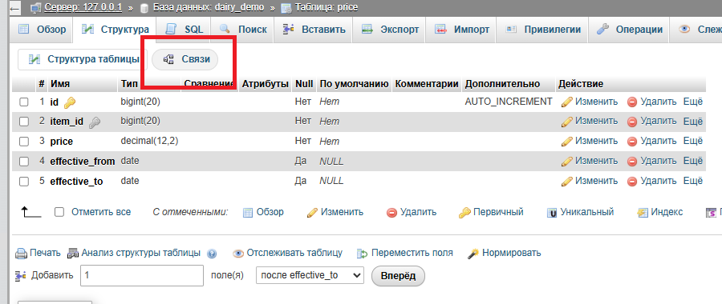

   /// caption
   Рисунок 23 – Переход в Relation view
   ///

Для каждой строки укажите правый столбец `id`.

| Таблица и поле FK | Таблица PK | Имя ограничения | ON DELETE |
|---|---|---|---|
| `price.item_id` | `item` | `fk_price_item` | RESTRICT |
| `specification.product_item_id` | `item` | `fk_spec_product` | RESTRICT |
| `specification.manufacturer_id` | `counterparty` | `fk_spec_manufacturer` | RESTRICT |
| `specification_material.specification_id` | `specification` | `fk_specmat_spec` | CASCADE |
| `specification_material.material_item_id` | `item` | `fk_specmat_material` | RESTRICT |
| `production_order.manufacturer_id` | `counterparty` | `fk_prodorder_manufacturer` | RESTRICT |
| `production_product_line.production_order_id` | `production_order` | `fk_prodprod_order` | CASCADE |
| `production_product_line.product_item_id` | `item` | `fk_prodprod_item` | RESTRICT |
| `production_material_line.production_order_id` | `production_order` | `fk_prodmat_order` | CASCADE |
| `production_material_line.material_item_id` | `item` | `fk_prodmat_item` | RESTRICT |
| `customer_order.executor_id` | `counterparty` | `fk_custorder_executor` | RESTRICT |
| `customer_order.customer_id` | `counterparty` | `fk_custorder_customer` | RESTRICT |
| `customer_order_line.customer_order_id` | `customer_order` | `fk_custline_order` | CASCADE |
| `customer_order_line.product_item_id` | `item` | `fk_custline_item` | RESTRICT |
| `cost_calculation.product_item_id` | `item` | `fk_costcalc_product` | RESTRICT |
| `cost_calculation_line.cost_calculation_id` | `cost_calculation` | `fk_costline_calc` | CASCADE |
| `cost_calculation_line.material_item_id` | `item` | `fk_costline_item` | RESTRICT |

### FK: price → item

   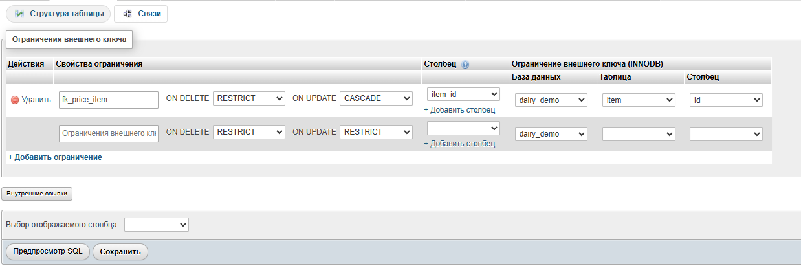

   /// caption
   Рисунок 24 – `price.item_id` → `item(id)` CASCADE/RESTRICT
   ///

### FK: specification

   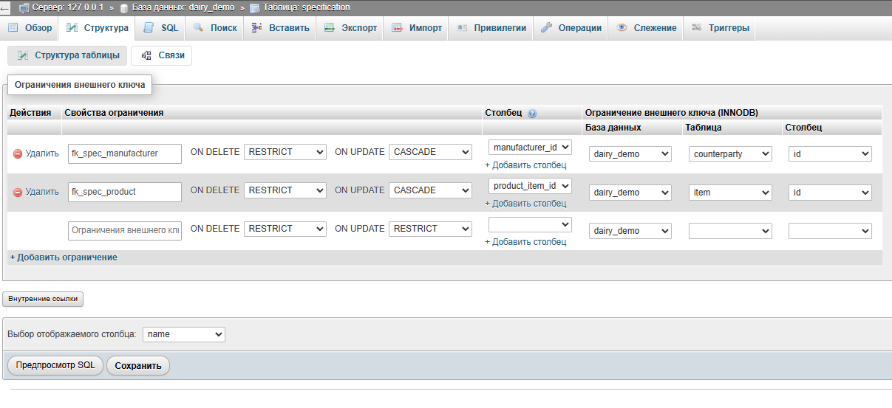

   /// caption
   Рисунок 25 – Связи таблицы `specification`
   ///

### FK: specification_material

   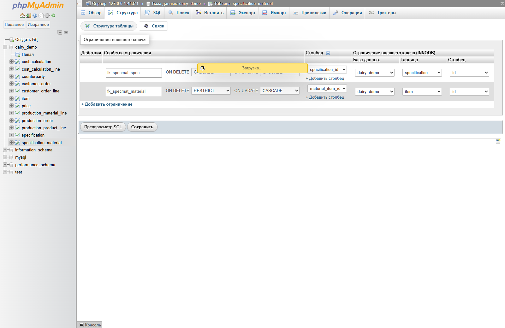

   /// caption
   Рисунок 26 – Связи таблицы `specification_material`
   ///

### FK: production_order

   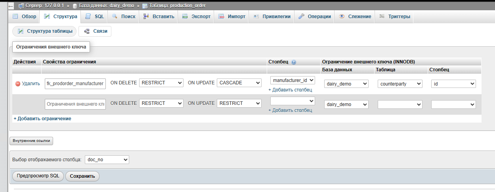

   /// caption
   Рисунок 27 – Связь `production_order` → `counterparty`
   ///

### FK: production_product_line

   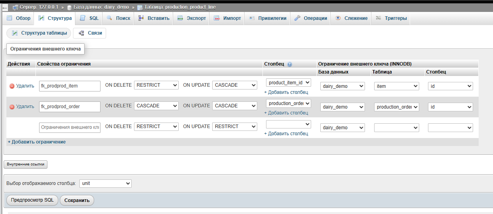

   /// caption
   Рисунок 28 – Связи `production_product_line`
   ///

### FK: production_material_line

   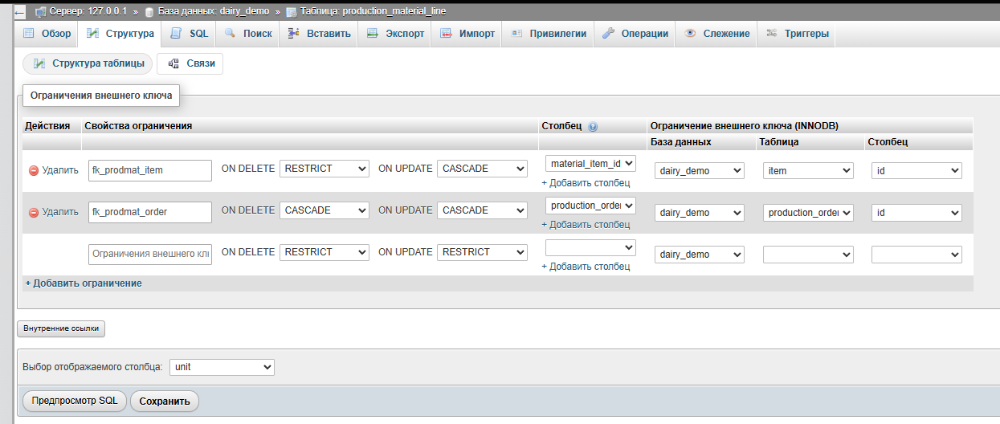

   /// caption
   Рисунок 29 – Связи `production_material_line`
   ///

### FK: customer_order

   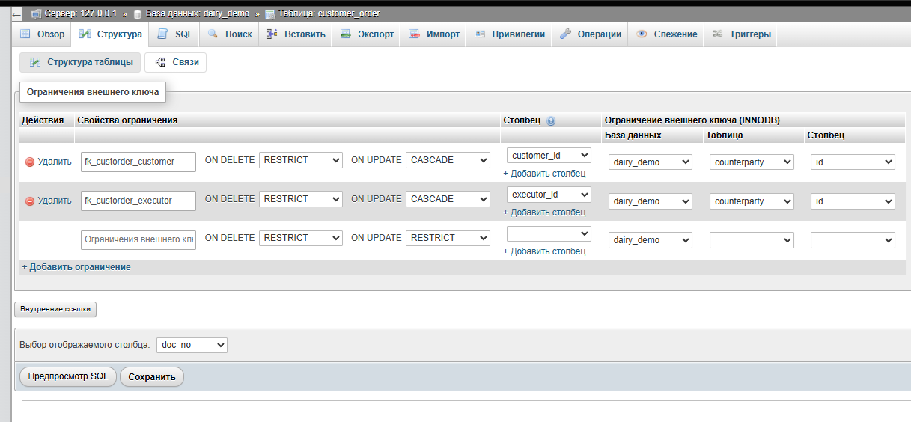

   /// caption
   Рисунок 30 – Связи `customer_order`
   ///

### FK: customer_order_line

   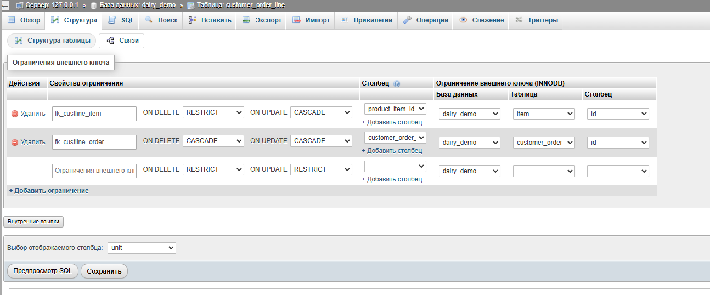

   /// caption
   Рисунок 31 – Связи `customer_order_line`
   ///

### FK: cost_calculation

   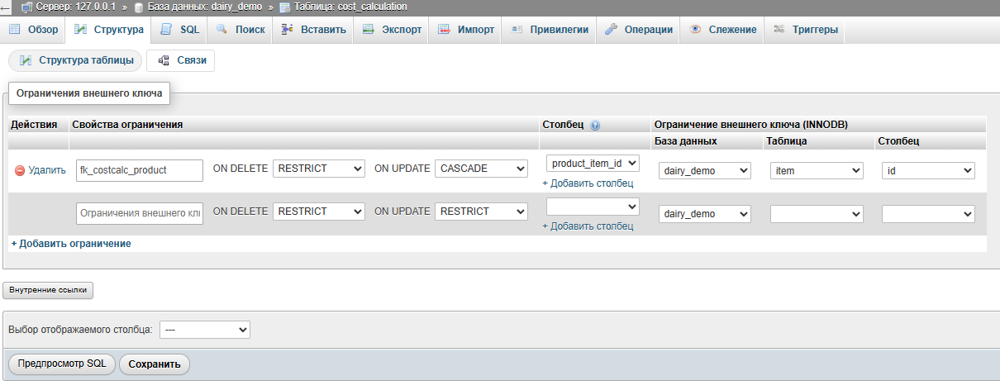

   /// caption
   Рисунок 32 – Связь `cost_calculation` → `item`
   ///

### FK: cost_calculation_line

   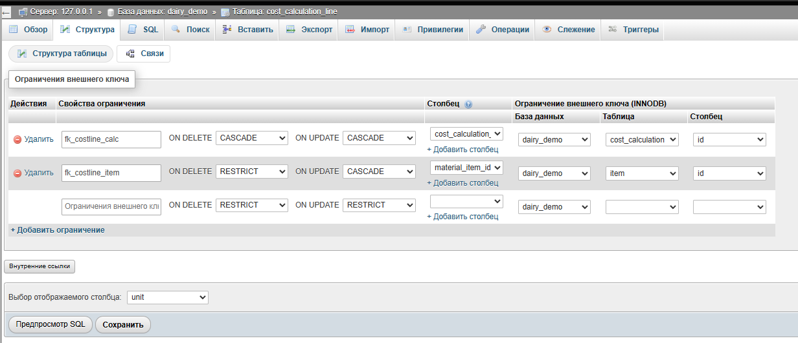

   /// caption
   Рисунок 33 – Связи `cost_calculation_line`
   ///

---

## Откройте исходный JSON в Excel

1. Распакуйте приложение к заданию 2 и найдите в нём [Заказчики.json](../../postgresql/assets/files/Заказчики.json).
2. Создайте пустую книгу Excel. Откройте **Данные → Получить данные → Из файла → Из JSON** и выберите этот файл.

   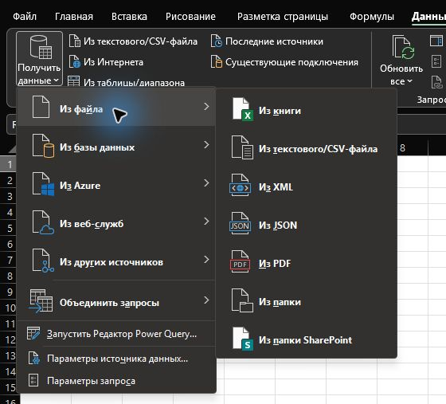

3. В редакторе Power Query появится список из шести строк `Record`. Нажмите **В таблицу**. В окне преобразования оставьте разделитель **Нет** и нажмите **ОК**.
4. В заголовке `Column1` нажмите кнопку с двумя стрелками. Отметьте все семь полей, снимите флажок **Использовать исходное имя столбца как префикс** и нажмите **ОК**.

   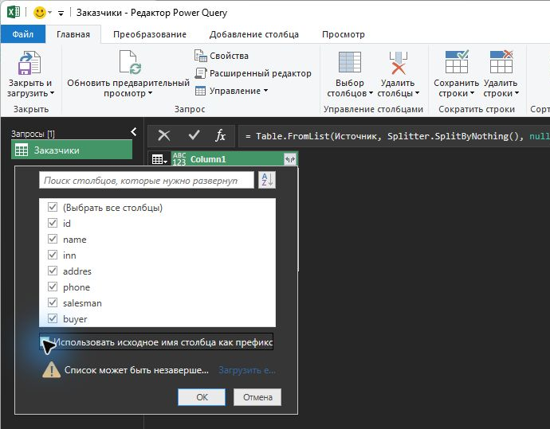

5. Нажмите **Главная → Закрыть и загрузить**. Excel создаст лист «Заказчики» с семью столбцами и шестью строками данных.

## Сохраните CSV для импорта

1. На листе «Заказчики» переименуйте заголовки `addres` → `address`, `salesman` → `is_salesman`, `buyer` → `is_buyer`. Сохраните порядок `id, name, inn, address, phone, is_salesman, is_buyer`.
2. В двух последних столбцах замените `ИСТИНА` (`TRUE`) на `1`, а `ЛОЖЬ` (`FALSE`) на `0`. Оставьте ИНН и телефоны такими, какими они загрузились из JSON. Проверьте знак `+` у телефонов и пустой ИНН у первой записи. В MySQL поле `id` числовое, поэтому значение `000000003` станет `3`.
3. Оставьте лист «Заказчики» активным. Нажмите **F12** и выберите **CSV UTF-8 (разделитель — запятая) (*.csv)**. Сохраните `Заказчики.csv`. Если Excel спросит о листах, подтвердите сохранение текущего листа.
4. Сделайте копию `Заказчики-импорт.csv` и откройте её в Блокноте. Посмотрите, чем разделены имена полей в первой строке. В зависимости от региональных настроек Excel это `,` или `;`.
5. В копии нажмите **Ctrl+Home**, **Shift+↓**, затем **Delete**. Сохраните файл. Первая строка должна начинаться с `000000001` и содержать данные первого заказчика. phpMyAdmin при импорте в существующую таблицу прочитает каждую строку файла как запись.

## Импортируйте шесть записей в counterparty

1. В phpMyAdmin откройте `dairy_demo` → `counterparty` → **Импорт**. В поле **Импортируемый файл** выберите `Заказчики-импорт.csv`.
2. Укажите формат **CSV**, кодировку **utf-8** и фактический **Разделитель полей** из Блокнота. Для **Значения полей обрамлены** и **Символ экранирования** оставьте двойную кавычку (`"`). Для **Разделитель строк** оставьте `auto`. Поле **Названия столбцов** оставьте пустым, поскольку порядок полей в файле совпадает с порядком полей в таблице.

   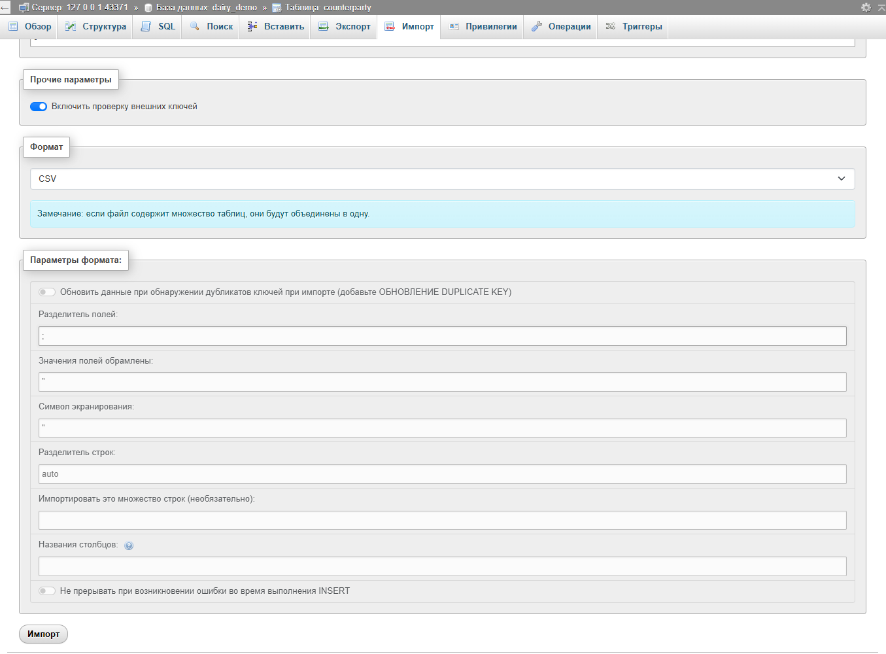

3. Нажмите **Импорт**. phpMyAdmin должен сообщить, что выполнено шесть запросов. Перейдите на вкладку **Обзор**. У записи `id = 3` сверьте адрес, ИНН `4140784214` и телефон `+79882584546`. У записи `id = 1` поле ИНН пустое.

---

## 6. Проверка структуры БД

После создания всех таблиц и связей откройте вкладку **Designer** для визуальной проверки ER.

   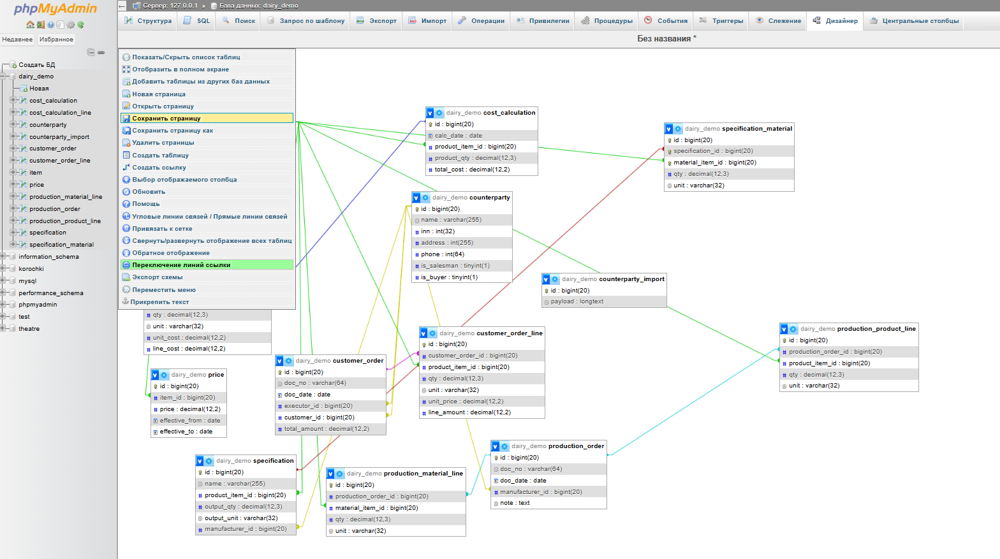

   /// caption
   Рисунок 36 – ER-диаграмма в Designer phpMyAdmin
   ///

   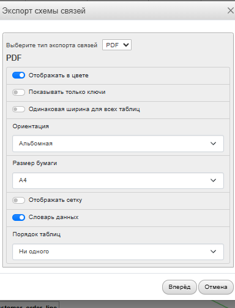

   /// caption
   Рисунок 37 – Экспорт структуры для подтверждения
   ///

## Выгрузите собственную базу

Выберите `dairy_demo` в левой панели. Убедитесь, что в заголовке указана база целиком. Откройте **Экспорт**, оставьте **Быстрый** способ и формат **SQL**. Нажмите **Экспорт** и сохраните полученный `dairy_demo.sql` в папку «База». В текстовом редакторе проверьте, что выгрузка содержит определения двенадцати таблиц, внешние ключи и строки из `counterparty`.

На домашней репетиции создайте отдельную базу `dairy_demo_check`, выберите её в левой панели и импортируйте туда свою выгрузку в формате **SQL**. Сверьте 12 таблиц и шесть записей в `counterparty`. Для задания 3 вернитесь в `dairy_demo`.

---
