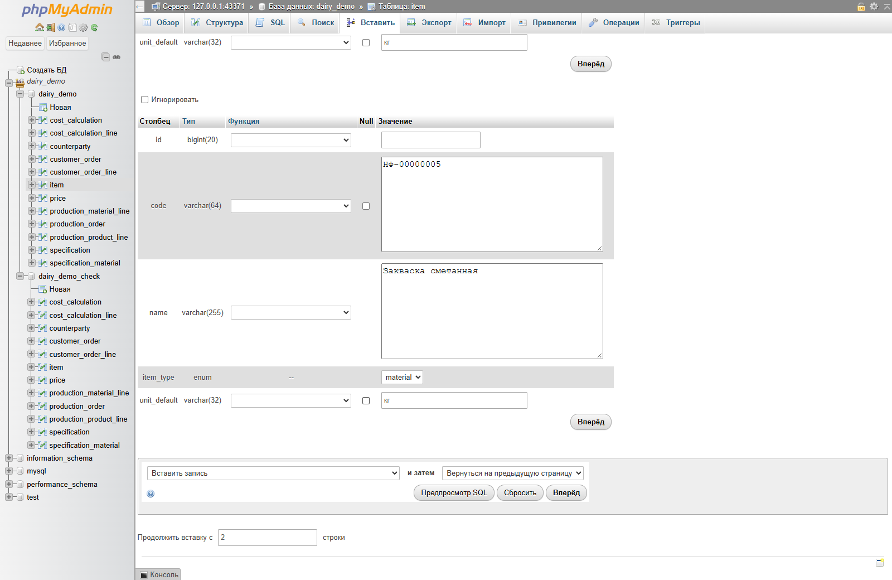
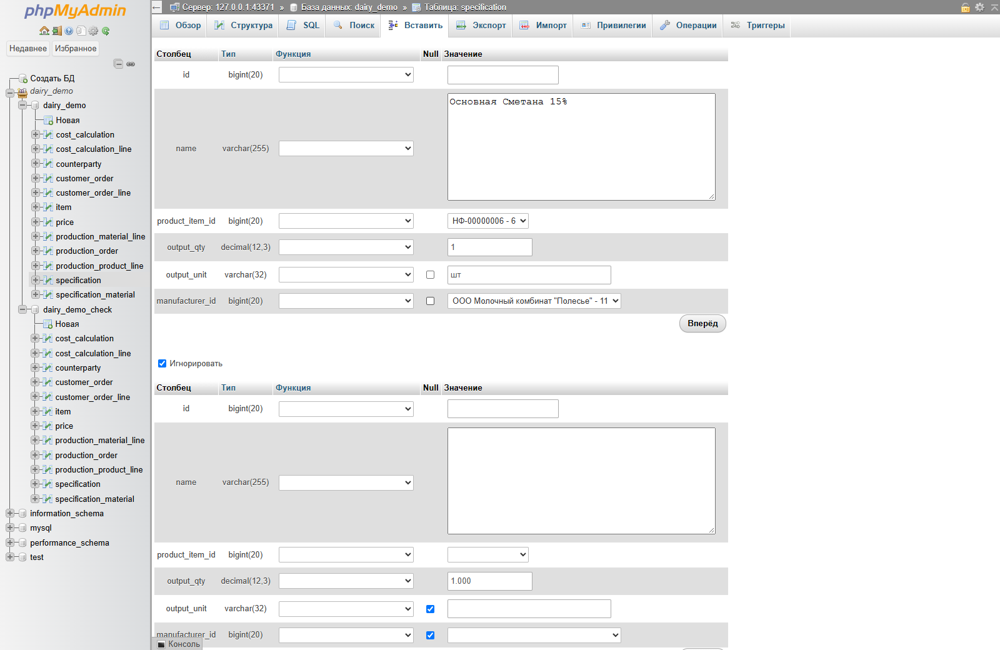
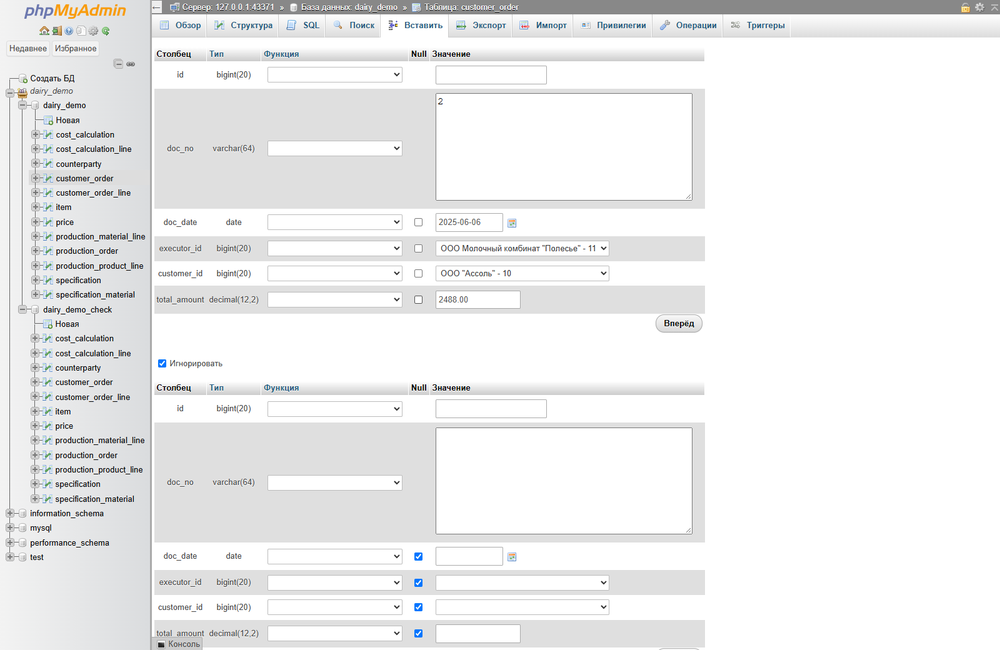
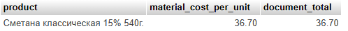
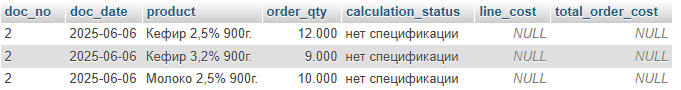

# Модуль 3. Расчёт стоимости заказа в MySQL / MariaDB

## Откройте базу из задания 2

В phpMyAdmin выберите `dairy_demo`. В таблице `counterparty` должны быть шесть записей из JSON. Возьмите исходные книги из задания 1. Заказ, прайс и калькуляция описывают разные величины.

- [Заказ покупателя.xlsx](../../postgresql/assets/files/Заказ%20покупателя.xlsx) содержит заказ № 2 и цены продажи на момент заказа.
- [Цены.xlsx](../../postgresql/assets/files/Цены.xlsx) содержит цены без дат действия.
- [Спецификация.xlsx](../../postgresql/assets/files/Спецификация.xlsx) содержит нормы выпуска и расхода для сметаны.
- [Производство.xlsx](../../postgresql/assets/files/Производство.xlsx) содержит выпуск, расход и коды номенклатуры.
- [Расчет стоимости продукции.xlsx](../../postgresql/assets/files/Расчет%20стоимости%20продукции.xlsx) содержит отдельную калькуляцию сметаны и цены, использованные в ней.

Чтобы добавить строку, выберите таблицу и откройте **Вставить**. Заполняйте поля в столбце **Значение**. У `id` оставляйте пустое поле, чтобы InnoDB выдал номер. Для отсутствующего необязательного реквизита оставьте **NULL**. Для поля, которое заполняете, снимите флажок **NULL**. **Вперёд** внизу сохраняет запись. Если заполняете вторую форму на странице, снимите **Игнорировать** над ней.

Ссылки выбирайте из списка по названию и номеру. Если показано только числовое поле, найдите фактический `id` в **Обзоре** родительской таблицы. Для десятичных чисел используйте точку, для дат — вид `ГГГГ-ММ-ДД`.

## Внесите материалы в item

В `item` откройте **Вставить**. Для обеих строк из документа «Производство» выберите `item_type = material` и `unit_default = кг`.

| name | code |
|---|---|
| Молоко нормализованное | НФ-00000004 |
| Закваска сметанная | НФ-00000005 |



## Внесите продукцию в item

В той же таблице добавьте продукцию из заказа, производства и прайса с `item_type = product`. В строках без кода или единицы в исходниках сохраните `NULL`.

| name | code | unit_default |
|---|---|---|
| Кефир 2,5% 900г. | NULL | шт |
| Кефир 3,2% 900г. | NULL | шт |
| Молоко 2,5% 900г. | NULL | шт |
| Сметана классическая 15% 540г. | НФ-00000006 | шт |
| Молоко 3,2% 900г. | NULL | NULL |
| Сметана классическая 20% 540г. | NULL | NULL |

В **Обзоре** должно быть восемь позиций, в том числе два материала. Используйте их номера в полях типа `item_id`.

## Внесите контрагентов и цены

В `counterparty` найдите `ООО "Ассоль"`, импортированное из JSON. Для исполнителя добавьте `ООО Молочный комбинат "Полесье"` из шапки заказа. Установите `is_salesman = 1`, оставьте `inn`, `address` и `phone` пустыми. Запомните `id` исполнителя и покупателя.

В `price` для каждой строки укажите `item_id` из `item` и значение `price` из «Цены.xlsx». В строках прайса нет дат. Оставьте `effective_from` и `effective_to` со значением `NULL`.

| Позиция | price |
|---|---:|
| Закваска сметанная | 45 |
| Кефир 2,5% 900г. | 80 |
| Кефир 3,2% 900г. | 82 |
| Молоко 2,5% 900г. | 70 |
| Молоко 3,2% 900г. | 76 |
| Молоко нормализованное | 34 |
| Сметана классическая 15% 540г. | 89 |
| Сметана классическая 20% 540г. | 92 |

## Внесите спецификацию в specification

Добавьте `Основная Сметана 15%`. В `product_item_id` выберите сметану 15%, в `manufacturer_id` — комбинат «Полесье». Укажите `output_qty = 1.000` и `output_unit = шт`. Количество выпуска нужно для перевода расхода всей партии в расход на одну единицу.



## Внесите нормы в specification_material

Откройте `specification_material` → **Вставить**. В обеих строках укажите `specification_id` созданной спецификации. В `material_item_id` выберите соответственно молоко нормализованное и закваску сметанную. Введите `qty = 0.900` и `0.070`, `unit = кг` для обеих строк. Сверьте нормы с «Спецификация.xlsx».

## Перенесите документ производства

В `production_order` добавьте документ `doc_no = 1` от `2025-06-09` и выберите комбинат «Полесье» в `manufacturer_id`. Найдите номер строки `id` в **Обзоре**.

В `production_product_line` добавьте выпуск сметаны 15% (`product_item_id`, `qty = 1.000`, `unit = шт`). В `production_material_line` добавьте молоко нормализованное (`qty = 0.900`) и закваску сметанную (`qty = 0.070`) в килограммах. Для всех трёх строк используйте `production_order_id` этой шапки. Эти данные описывают фактический выпуск и расход.

## Внесите заказ № 2 в customer_order

В форму `customer_order` перенесите `doc_no = 2`, `doc_date = 2025-06-06`, `total_amount = 2488.00`. Для `executor_id` выберите комбинат «Полесье», для `customer_id` — ООО «Ассоль». Нажмите **Вперёд** и найдите номер строки `id` через **Обзор**.



## Внесите позиции в customer_order_line

Добавьте три строки с одним `customer_order_id`. В `product_item_id` выбирайте соответствующий товар из `item`. Во всех строках `unit = шт`.

| Продукция | qty | unit_price | line_amount |
|---|---:|---:|---:|
| Кефир 2,5% 900г. | 12 | 80.00 | 960.00 |
| Кефир 3,2% 900г. | 9 | 82.00 | 738.00 |
| Молоко 2,5% 900г. | 10 | 79.00 | 790.00 |

Цена молока в самом заказе — 79.00. В отдельном прайсе — 70.00. Сохраните каждое значение в его таблице, чтобы цена в заказе оставалась такой, как в документе.

## Сохраните контрольную калькуляцию

В `cost_calculation` добавьте строку со ссылкой на сметану 15%, `product_qty = 1.000`, `total_cost = 36.70` и `calc_date = NULL`. Сверьте с книгой «Расчет стоимости продукции».

В `cost_calculation_line` добавьте две строки с `cost_calculation_id` из **Обзора** и `material_item_id` каждого материала.

| Материал | qty | unit | unit_cost | line_cost |
|---|---:|---|---:|---:|
| Молоко нормализованное | 0.900 | кг | 40.00 | 36.00 |
| Закваска сметанная | 0.070 | кг | 10.00 | 0.70 |

Эти цены относятся к контрольной калькуляции. Прайс хранится отдельно в `price`.

## Проверьте формулу на калькуляции сметаны

Выберите базу `dairy_demo` и вкладку **SQL**. Вставьте запрос и нажмите **Вперёд**. Сложите стоимость материалов, затем разделите на количество выпущенных единиц. `NULLIF` защищает от деления на ноль. Округление до копеек применяется к результату.

```sql
SELECT product.name AS product,
       ROUND(SUM(line.qty * line.unit_cost) / NULLIF(calc.product_qty, 0), 2) AS material_cost_per_unit,
       calc.total_cost AS document_total
FROM cost_calculation AS calc
JOIN item AS product ON product.id = calc.product_item_id
JOIN cost_calculation_line AS line ON line.cost_calculation_id = calc.id
GROUP BY calc.id, product.name, calc.product_qty, calc.total_cost;
```

Ручная сверка для одной упаковки сметаны даёт `(0.900 × 40 + 0.070 × 10) / 1 = 36.70` ₽. В запросе `material_cost_per_unit` и `document_total` должны совпасть.



## Проверьте исходные строки заказа

Сначала выполните простую выборку. Именно эти позиции должны остаться в итоговой таблице после добавления норм, в том числе если для позиции отсутствует спецификация.

```sql
SELECT o.doc_no, o.doc_date, product.name, l.qty, l.line_amount
FROM customer_order AS o
JOIN customer_order_line AS l ON l.customer_order_id = o.id
JOIN item AS product ON product.id = l.product_item_id
WHERE o.doc_no = '2' AND o.doc_date = '2025-06-06'
ORDER BY l.id;
```

У заказа три позиции. Сумма `960 + 738 + 790 = 2 488` ₽ показывает выручку по документу. Для себестоимости понадобятся нормы и цены материалов.

## Итог по заказу

1. В `spec_candidates` посчитайте спецификации каждого товара. Если спецификация одна, используйте её `id`. Если их несколько, потребуется уточнить, какая действовала для заказа.
2. В `components` сохраните все позиции заказа с помощью `LEFT JOIN`. Для каждого материала выберите одну цену. Сначала ищите датированную цену, действовавшую на день заказа. Если её нет, используйте недатированную цену из приложенного прайса. При совпадении даты выберите строку с большим `id`, чтобы не посчитать один материал дважды.
3. В `line_check` сгруппируйте материалы позиции. Если у каждого компонента есть цена и указано количество выпуска, полученную стоимость партии разделите на выпуск. Сохраните причину, если расчёт невозможен.
4. В `priced_lines` умножьте цену материалов на количество изделий. Итог по заказу вычисляйте только тогда, когда рассчитаны все позиции. `OVER (PARTITION BY order_id)` позволяет показать итог рядом со строками для сверки.

```sql
WITH spec_candidates AS (
    SELECT product_item_id, COUNT(*) AS spec_count, MIN(id) AS spec_id
    FROM specification
    GROUP BY product_item_id
),
components AS (
    SELECT o.id AS order_id, o.doc_no, o.doc_date, l.id AS line_id,
           product.name AS product, l.qty AS order_qty,
           source.spec_count, s.output_qty, sm.id AS component_id,
           sm.qty AS material_qty, p.price
    FROM customer_order AS o
    JOIN customer_order_line AS l ON l.customer_order_id = o.id
    JOIN item AS product ON product.id = l.product_item_id
    LEFT JOIN spec_candidates AS source ON source.product_item_id = l.product_item_id
    LEFT JOIN specification AS s ON s.id = source.spec_id AND source.spec_count = 1
    LEFT JOIN specification_material AS sm ON sm.specification_id = s.id
    LEFT JOIN price AS p ON p.id = (
        SELECT applicable.id
        FROM price AS applicable
        WHERE applicable.item_id = sm.material_item_id
          AND (applicable.effective_from IS NULL OR applicable.effective_from <= o.doc_date)
          AND (applicable.effective_to IS NULL OR applicable.effective_to >= o.doc_date)
        ORDER BY applicable.effective_from IS NULL, applicable.effective_from DESC, applicable.id DESC
        LIMIT 1
    )
    WHERE o.doc_no = '2' AND o.doc_date = '2025-06-06'
),
line_check AS (
    SELECT order_id, doc_no, doc_date, line_id, product, order_qty,
           CASE
               WHEN MAX(spec_count) IS NULL THEN 'нет спецификации'
               WHEN MAX(spec_count) > 1 THEN 'несколько спецификаций'
               WHEN MAX(output_qty) IS NULL OR MAX(output_qty) <= 0 THEN 'нет нормы выпуска'
               WHEN COUNT(component_id) = 0 THEN 'нет состава материалов'
               WHEN COUNT(price) < COUNT(component_id) THEN 'нет цены материала'
               ELSE 'рассчитано'
           END AS calculation_status,
           SUM(material_qty * price) / NULLIF(MAX(output_qty), 0) AS material_cost_per_unit
    FROM components
    GROUP BY order_id, doc_no, doc_date, line_id, product, order_qty
),
priced_lines AS (
    SELECT order_id, doc_no, doc_date, line_id, product, order_qty, calculation_status,
           CASE WHEN calculation_status = 'рассчитано' THEN order_qty * material_cost_per_unit END AS line_cost
    FROM line_check
)
SELECT doc_no, doc_date, product, order_qty, calculation_status, ROUND(line_cost, 2) AS line_cost,
       CASE WHEN COUNT(line_cost) OVER (PARTITION BY order_id) = COUNT(*) OVER (PARTITION BY order_id)
            THEN ROUND(SUM(line_cost) OVER (PARTITION BY order_id), 2)
       END AS total_order_cost
FROM priced_lines
ORDER BY order_id, line_id;
```

## Сверьте и сохраните результат

| Продукция заказа № 2 | Количество | Статус расчёта |
|---|---:|---|
| Кефир 2,5% 900г. | 12 | нет спецификации |
| Кефир 3,2% 900г. | 9 | нет спецификации |
| Молоко 2,5% 900г. | 10 | нет спецификации |

На исходных данных обе колонки стоимости в итоговой выборке будут `NULL`. Три позиции сохранены, а запрос указывает, что именно требуется для расчёта. Число `36.70` из контрольной калькуляции относится к отдельному изделию. Число `2488.00` взято из колонки продажи в заказе.



Сохраните итоговый запрос в `Запрос стоимости.sql` в своей папке «База». Сохраните снимок трёх строк заказа и отдельно снимок контрольной калькуляции.
