# Модуль 4. Авторизация через конструктор Windows Forms

## Создайте таблицу users в phpMyAdmin

Откройте `dairy_demo` из задания 3. На вкладке **Структура** введите имя `users` и восемь столбцов. В конструкторе заполните поля по таблице. Во всех строках оставьте **Null** выключенным.

| Имя | Тип | Длина/Значения | По умолчанию | Дополнительные настройки |
|---|---|---|---|---|
| `id` | BIGINT | пусто | Нет | **A_I**, индекс **PRIMARY** |
| `login` | VARCHAR | 64 | Нет | индекс **UNIQUE**, имя `uq_users_login` |
| `password_hash` | VARCHAR | 255 | Нет | |
| `role` | ENUM | `'admin','user'` | Как определено → `user` | |
| `failed_attempts` | INT | пусто | Как определено → `0` | атрибут **UNSIGNED** |
| `is_locked` | TINYINT | 1 | Как определено → `0` | |
| `created_at` | TIMESTAMP | пусто | **CURRENT_TIMESTAMP** | |
| `updated_at` | TIMESTAMP | пусто | **CURRENT_TIMESTAMP** | атрибут **on update CURRENT_TIMESTAMP** |

Тип таблицы — **InnoDB**. Для `login` выберите **UNIQUE**, подтвердите имя индекса и столбец `login` в отдельном окне через **Вперёд**. Сохраните таблицу. На вкладке **Структура** проверьте оба индекса. На вкладке **Обзор** пока нет записей.

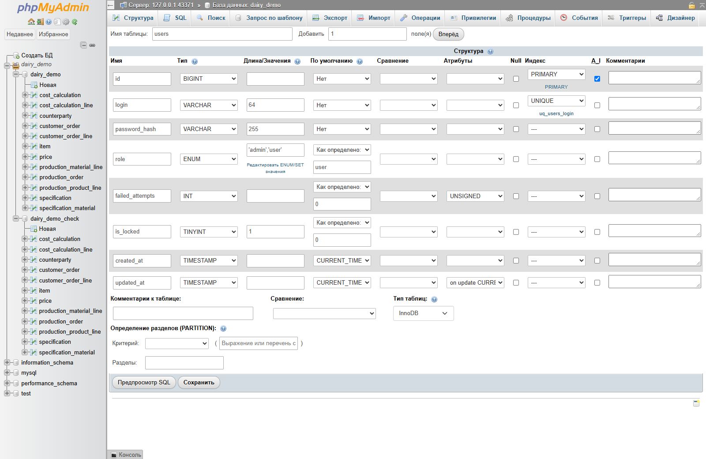

Уникальный индекс защищает от повторяющихся логинов. В отдельном столбце пароля будет хеш BCrypt. Счётчик и флаг блокировки в базе сохраняются после перезапуска программы.

## Создайте решение и подключите библиотеки

Запустите Visual Studio 2026. Выберите шаблон **Приложение Windows Forms (Майкрософт)** с меткой **C#**. Имя проекта `DairyDemo.Auth`, платформа **.NET 10.0**. Visual Studio создаст решение и стандартную форму.

Положите сохранённые на этапе 0 `NuGet.Config` и папку `nuget-packages` рядом с файлом решения. Если решение уже открыто, закройте и снова откройте его, чтобы Visual Studio перечитала конфигурацию. Выберите проект → **Проект → Управление пакетами NuGet**. Из источника **DKIP offline** установите `MySqlConnector 2.6.1` и `BCrypt.Net-Next 4.0.3`. Нажмите **Сохранить всё**. На вкладке **Установлено** проверьте обе версии.

## Добавьте четыре формы в папку Forms

В **Обозревателе решений** выделите проект. В верхнем меню выберите **Проект → Создать папку** и назовите её `Forms`. Выделите папку и выберите **Проект → Добавить форму (Windows Forms)**. В поле **Имя** введите `LoginForm.cs` и нажмите **Добавить**. Тем же способом создайте `UserForm.cs`, `AdminForm.cs` и `UserEditForm.cs`. Если форма добавилась с временным именем, нажмите **F2** на её файле и подтвердите переименование ссылок на класс.

Чтобы открыть визуальный редактор, дважды щёлкните по файлу формы. Откройте **Панель элементов** через **Ctrl+Alt+X** и ищите контрол по названию. Дважды щёлкните по найденному контролу. Он появится на выбранной форме. В окне **Свойства** (**F4**) установите `(Name)`, `Text`, `Location` и `Size` по следующим карточкам. Координаты считаются от левого верхнего угла клиентской области.

Visual Studio запишет размещение в `*.Designer.cs`. Код логики добавляется в файл без `.Designer` в имени. Каждый контрол с именем из таблицы используется обработчиком. Сверьте буквы и цифры в `(Name)` перед переходом к коду.

## Соберите LoginForm

На пустой области формы выберите `Text = Молочный комбинат «Полесье» — вход`, `Size = 730 × 438`, `MinimumSize = 730 × 438`, `FormBorderStyle = FixedDialog`, `MaximizeBox = False` и `StartPosition = CenterScreen`. После добавления кнопки установите `AcceptButton = btnLogin`, чтобы срабатывал Enter.

| Контрол | (Name) | X, Y | Размер или свойство |
|---|---|---|---|
| Label | `lblCompany` | 35, 24 | Text = Молочный комбинат «Полесье», Font = Segoe UI 16 pt жирный |
| Label | `lblLogin` | 35, 101 | Text = Логин |
| TextBox | `tbLogin` | 35, 124 | 250 × 23, MaxLength = 64 |
| Label | `lblPassword` | 35, 161 | Text = Пароль |
| TextBox | `tbPassword` | 35, 184 | 250 × 23, UseSystemPasswordChar = True |
| Button | `btnLogin` | 35, 243 | 155 × 35, Text = Войти |
| Label | `lblPuzzle` | 337, 47 | Text = Соберите пазл. Щёлкните по двум фрагментам. |
| PictureBox | `piece1` | 337, 76 | 156 × 156, SizeMode = Zoom, BorderStyle = FixedSingle |
| PictureBox | `piece2` | 497, 76 | те же свойства |
| PictureBox | `piece3` | 337, 236 | те же свойства |
| PictureBox | `piece4` | 497, 236 | те же свойства |

Добавьте поля в порядке логин, пароль, кнопка. Если меняли порядок, сверьте `TabIndex` в окне свойств. Поле пароля маскирует ввод. Четыре `PictureBox` одинакового размера образуют пазл 2 × 2.

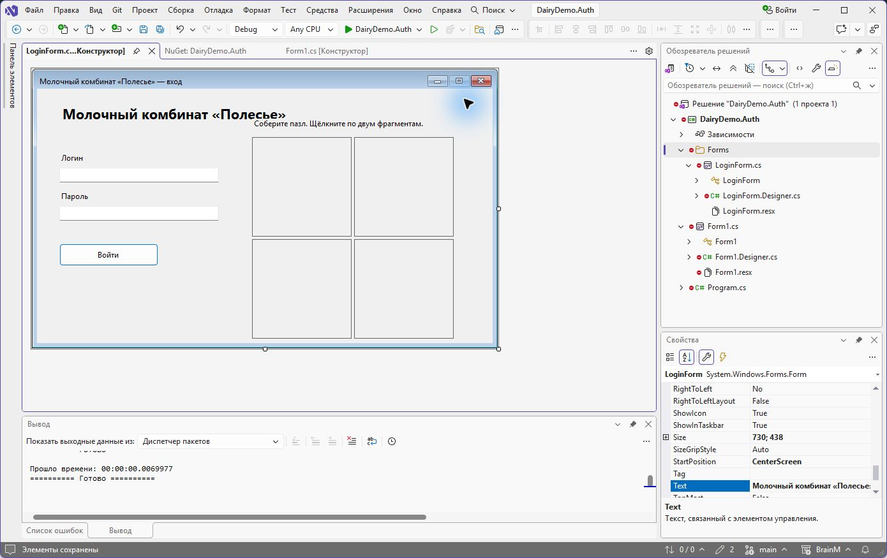

## Соберите UserForm

Поставьте заголовок **Молочный комбинат «Полесье» — пользователь**. Размер и минимальный размер 500 × 220. `FormBorderStyle = FixedDialog`, `MaximizeBox = False`, `StartPosition = CenterScreen`.

| Контрол | (Name) | X, Y | Свойства |
|---|---|---|---|
| Label | `lblWelcome` | 27, 32 | Text = Вы вошли в систему. Роль: Пользователь., Font = Segoe UI 12 pt |
| Button | `btnExit` | 27, 103 | 150 × 34, Text = Выйти |

Окно показывает роль и кнопку возвращения к экрану входа. Текст метки обновится после входа под конкретным логином.

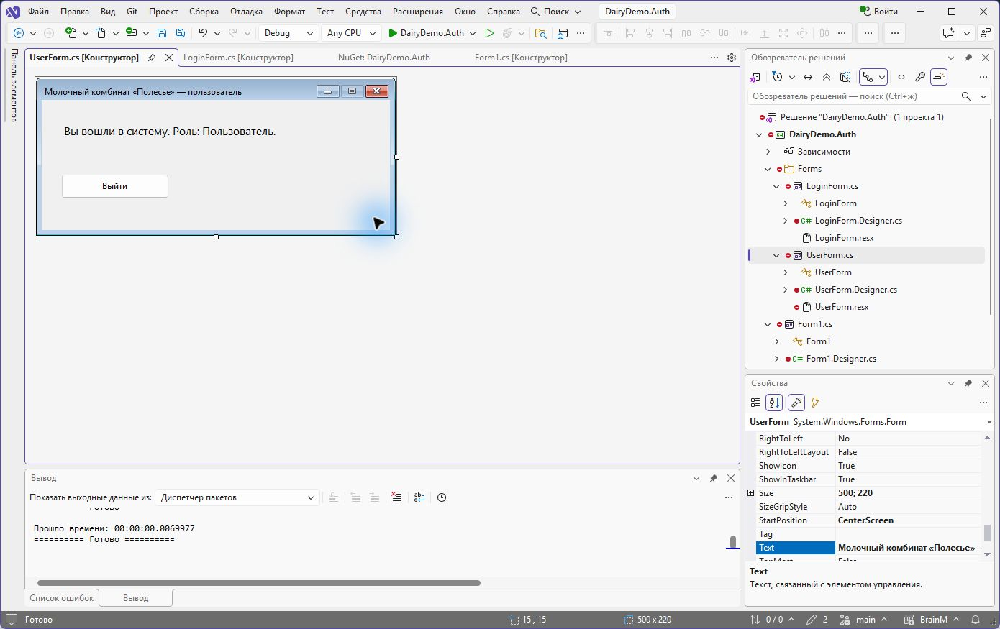

## Соберите AdminForm

Заголовок формы **Молочный комбинат «Полесье» — администратор**. Размер 860 × 505, минимальный размер 780 × 480, `StartPosition = CenterScreen`, `FormBorderStyle = Sizable`.

| Контрол | (Name) | X, Y | Размер | Текст |
|---|---|---|---|---|
| Button | `btnAdd` | 20, 25 | 120 × 34 | Добавить |
| Button | `btnEdit` | 154, 25 | 120 × 34 | Изменить |
| Button | `btnUnlock` | 288, 25 | 158 × 34 | Снять блокировку |
| Button | `btnClose` | 704, 25 | 115 × 34 | Выйти |
| DataGridView | `gridUsers` | 20, 83 | 810 × 355 | |

Для `btnClose` привяжите `Anchor` к верхнему и правому краям. Для `gridUsers` отметьте все четыре края в `Anchor`, чтобы она меняла размер вместе с окном. Поставьте `AutoSizeColumnsMode = Fill`, `ReadOnly = True`, `SelectionMode = FullRowSelect`, `MultiSelect = False`, `AllowUserToAddRows = False` и `AllowUserToDeleteRows = False`. Таблица показывает одну выбранную запись, а изменение происходит через отдельную форму с проверкой полей.

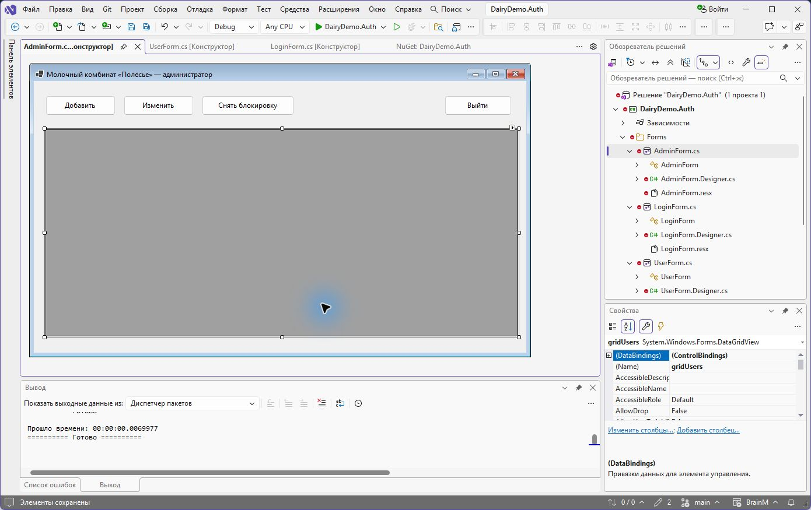

## Соберите UserEditForm

Выберите размер и минимальный размер 470 × 312, `FormBorderStyle = FixedDialog`, `MaximizeBox = False`, `StartPosition = CenterParent` и заголовок **Полесье — учётная запись**.

| Контрол | (Name) | X, Y | Размер или свойство |
|---|---|---|---|
| Label | `lblEditLogin` | 24, 19 | Text = Логин |
| TextBox | `tbEditLogin` | 24, 41 | 380 × 23, MaxLength = 64 |
| Label | `lblEditPassword` | 24, 80 | Text = Пароль |
| TextBox | `tbEditPassword` | 24, 102 | 380 × 23, UseSystemPasswordChar = True |
| Label | `lblRole` | 24, 141 | Text = Роль |
| ComboBox | `cbRole` | 24, 163 | 380 × 23, DropDownStyle = DropDownList |
| Button | `btnSave` | 24, 215 | 130 × 34, Text = Сохранить |
| Button | `btnCancel` | 169, 215 | 130 × 34, Text = Отмена, DialogResult = Cancel |

Закрытый список `DropDownList` исключает ввод произвольной роли. Код диалога заполнит его двумя разрешёнными ролями. У формы задайте `AcceptButton = btnSave` и `CancelButton = btnCancel`. Один диалог будет использоваться для первого администратора, добавления и редактирования.

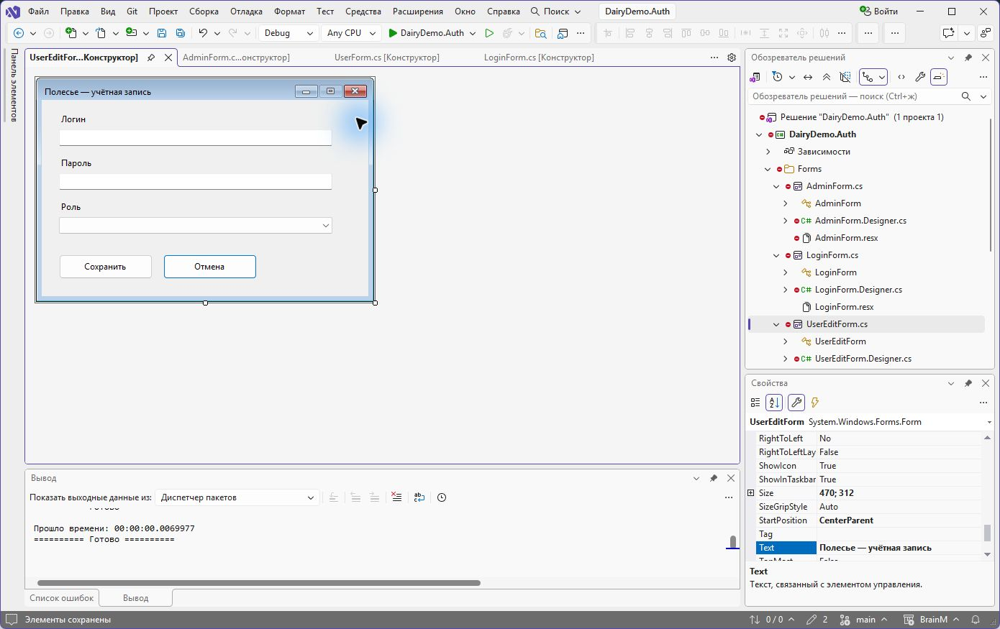

## Добавьте фрагменты пазла и параметры БД

Распакуйте приложение к заданию 4. В проекте через **Проект → Создать папку** создайте `Assets`, в ней — `captcha`. Скопируйте в неё `1.png`, `2.png`, `3.png` и `4.png` из приложения к КОД. Для файлов в **Свойствах** установите **Действие при сборке → Содержимое** и **Копировать в выходной каталог → Копировать более позднюю версию**. После компиляции должны появиться `bin/Debug/net10.0-windows/Assets/captcha/1.png` и остальные три файла.

В корне проекта создайте текстовый файл `db-connection.txt`. Впишите строку подключения для своей установки. Пример для локальной MariaDB XAMPP на стандартном порту с пустым паролем `root`:

```text
Server=127.0.0.1;Port=3306;Database=dairy_demo;Uid=root;Pwd=;SslMode=None;
```

Если на вашем компьютере другие параметры, подставьте фактические сервер, порт, пользователя и пароль. Для файла также выберите **Содержимое** и **Копировать более позднюю версию**. При сдаче добавьте пользователю инструкцию заполнения, а личный пароль храните локально.

## Добавьте модель и подключение

Выделите корень проекта и создайте в нём папку `Data`. Для каждого файла выберите папку → **Проект → Добавить класс** и введите имя. Вставьте код в созданный файл и сохраните. `User` описывает одну запись, `Db` читает настройки рядом с EXE. Подключение к MySQL создаётся заново для каждой операции и закрывается после неё.

### Data/User.cs

```csharp
namespace DairyDemo.Auth.Data;

public sealed record User(long Id, string Login, string PasswordHash, string Role,
    int FailedAttempts, bool IsLocked);
```

### Data/Db.cs

```csharp
using MySqlConnector;

namespace DairyDemo.Auth.Data;

public static class Db
{
    public static MySqlConnection CreateConnection()
    {
        var value = Environment.GetEnvironmentVariable("DKIP_DB_CONNECTION");
        var path = Path.Combine(AppContext.BaseDirectory, "db-connection.txt");
        if (string.IsNullOrWhiteSpace(value) && File.Exists(path))
            value = File.ReadAllText(path).Trim();

        if (string.IsNullOrWhiteSpace(value))
            throw new InvalidOperationException("Укажите подключение к базе в db-connection.txt.");

        return new MySqlConnection(value);
    }
}
```

## Добавьте запросы пользователей

В папке `Data` создайте `UserRepository.cs`. В запросах значения полей передаются отдельно через параметры. `FindAsync` получает одну запись по логину, `ListAsync` загружает таблицу для администратора, `SaveAsync` добавляет или редактирует строку. `AddFailedAttemptAsync` блокирует на третьей ошибке. В запросе MySQL условие блокировки использует счётчик до увеличения. `ResetAfterSuccessAsync` сбрасывает число промахов при успешном входе, `UnlockAsync` снимает флаг и обнуляет счётчик.

```csharp
using MySqlConnector;

namespace DairyDemo.Auth.Data;

public sealed class UserRepository
{
    private const string Fields = "id, login, password_hash, role, failed_attempts, is_locked";

    public async Task<User?> FindAsync(string login)
    {
        var users = await ReadAsync($"SELECT {Fields} FROM users WHERE login = @login", ("@login", login));
        return users.SingleOrDefault();
    }

    public Task<List<User>> ListAsync() => ReadAsync($"SELECT {Fields} FROM users ORDER BY id");

    public Task<bool> HasUsersAsync() => WithCommandAsync(
        "SELECT EXISTS(SELECT 1 FROM users)",
        async command => Convert.ToInt32(await command.ExecuteScalarAsync()) == 1);

    public Task<int> SaveAsync(long? id, string login, string role, string? hash)
    {
        var hashValue = (object?)hash ?? DBNull.Value;
        if (id is null)
            return ChangeAsync(
                "INSERT INTO users (login, password_hash, role) VALUES (@login, @hash, @role)",
                ("@login", login), ("@hash", hashValue), ("@role", role));

        return ChangeAsync("""
            UPDATE users
            SET login = @login, role = @role, password_hash = COALESCE(@hash, password_hash)
            WHERE id = @id
            """, ("@login", login), ("@role", role), ("@hash", hashValue), ("@id", id.Value));
    }

    public async Task<bool> AddFailedAttemptAsync(long id)
    {
        // В списке SET сначала проверяем прежний счётчик, затем увеличиваем его.
        await ChangeAsync("""
            UPDATE users
            SET is_locked = (failed_attempts >= 2), failed_attempts = failed_attempts + 1
            WHERE id = @id AND is_locked = 0
            """, ("@id", id));

        return await WithCommandAsync(
            "SELECT is_locked FROM users WHERE id = @id",
            async command => Convert.ToBoolean(await command.ExecuteScalarAsync()), ("@id", id));
    }

    public Task<int> ResetAfterSuccessAsync(long id) => ChangeAsync(
        "UPDATE users SET failed_attempts = 0 WHERE id = @id AND is_locked = 0", ("@id", id));

    public Task<int> UnlockAsync(long id) => ChangeAsync(
        "UPDATE users SET is_locked = 0, failed_attempts = 0 WHERE id = @id", ("@id", id));

    private Task<int> ChangeAsync(string sql, params (string Name, object Value)[] parameters) =>
        WithCommandAsync(sql, command => command.ExecuteNonQueryAsync(), parameters);

    private Task<List<User>> ReadAsync(string sql, params (string Name, object Value)[] parameters) =>
        WithCommandAsync(sql, async command =>
        {
            await using var reader = await command.ExecuteReaderAsync();
            var users = new List<User>();
            while (await reader.ReadAsync())
            {
                users.Add(new User(reader.GetInt64(0), reader.GetString(1), reader.GetString(2),
                    reader.GetString(3), reader.GetInt32(4), reader.GetBoolean(5)));
            }
            return users;
        }, parameters);

    private static async Task<T> WithCommandAsync<T>(string sql, Func<MySqlCommand, Task<T>> run,
        params (string Name, object Value)[] parameters)
    {
        await using var connection = Db.CreateConnection();
        await connection.OpenAsync();
        await using var command = connection.CreateCommand();
        command.CommandText = sql;
        foreach (var (name, value) in parameters)
            command.Parameters.AddWithValue(name, value);

        return await run(command);
    }
}
```

## Добавьте проверку пароля и входа

Выделите корень проекта и создайте папку `Services`. Добавьте в неё два класса. BCrypt формирует хеш с солью и проверяет пароль по хешу из БД. В `AuthService.LoginAsync` сначала проверяется наличие пользователя и флаг блокировки, затем пароль и пазл. Один клик по «Войти» увеличивает счётчик максимум на единицу. В случае успеха программа обнуляет счётчик и выбирает окно по роли.

### Services/PasswordService.cs

```csharp
using System.Text;

namespace DairyDemo.Auth.Services;

public static class PasswordService
{
    public static bool FitsBcrypt(string password) => Encoding.UTF8.GetByteCount(password) <= 72;

    public static string Hash(string password) => BCrypt.Net.BCrypt.HashPassword(password, workFactor: 11);

    public static bool Verify(string password, string hash) =>
        FitsBcrypt(password) && BCrypt.Net.BCrypt.Verify(password, hash);
}
```

### Services/AuthService.cs

```csharp
using DairyDemo.Auth.Data;

namespace DairyDemo.Auth.Services;

public sealed class AuthService(UserRepository repository)
{
    private const string WrongCredentials =
        "Вы ввели неверный логин или пароль. Пожалуйста проверьте ещё раз введенные данные";
    private const string Locked = "Вы заблокированы. Обратитесь к администратору";

    public async Task<(User? User, string Message)> LoginAsync(string login, string password, bool puzzleSolved)
    {
        var user = await repository.FindAsync(login);
        if (user is null)
            return (null, WrongCredentials);
        if (user.IsLocked)
            return (null, Locked);

        var correctPassword = PasswordService.Verify(password, user.PasswordHash);
        // Для найденной записи обе ошибки учитываются в одном счётчике.
        if (!correctPassword || !puzzleSolved)
        {
            if (await repository.AddFailedAttemptAsync(user.Id))
                return (null, Locked);

            return (null, correctPassword ? "Соберите изображение для подтверждения" : WrongCredentials);
        }

        if (await repository.ResetAfterSuccessAsync(user.Id) == 0)
            return (null, Locked);

        return (user, "Вы успешно авторизовались");
    }
}
```

## Добавьте логику LoginForm

Нажмите **F7** на форме или выберите **Просмотреть код** и откройте `Forms/LoginForm.cs`. Вставьте код в этот файл. Вызов `InitializeComponent()` загружает контролы из конструктора. События подписываются в конструкторе класса, поэтому кнопки не требуют дополнительных подписок в панели «События».

Метод `ShufflePuzzle` перемешивает фрагменты. Обработчик `Piece_Click` запоминает первый выбор и меняет два индекса после второго клика. `LoginForm_Shown` загружает четыре изображения. Если база пуста, открывается форма настройки первого администратора. `BtnLogin_Click` проверяет обязательные поля, вызывает службу входа и открывает окно по роли.

```csharp
using DairyDemo.Auth.Data;
using DairyDemo.Auth.Services;
using MySqlConnector;

namespace DairyDemo.Auth.Forms;

public partial class LoginForm : Form
{
    private readonly UserRepository _repository = new();
    private readonly AuthService _auth;
    private readonly PictureBox[] _pieces;
    private readonly List<Image> _images = new();
    private readonly int[] _order = [0, 1, 2, 3];
    private int _selectedPiece = -1;

    public LoginForm()
    {
        InitializeComponent();
        _auth = new AuthService(_repository);
        _pieces = [piece1, piece2, piece3, piece4];

        Shown += LoginForm_Shown;
        FormClosed += LoginForm_FormClosed;
        btnLogin.Click += BtnLogin_Click;
        foreach (var piece in _pieces)
            piece.Click += Piece_Click;
    }

    private bool PuzzleSolved => _order.AsSpan().SequenceEqual([0, 1, 2, 3]);

    private async void LoginForm_Shown(object? sender, EventArgs e)
    {
        btnLogin.Enabled = false;
        try
        {
            for (var number = 1; number <= _pieces.Length; number++)
            {
                var path = Path.Combine(AppContext.BaseDirectory, "Assets", "captcha", $"{number}.png");
                _images.Add(Image.FromFile(path));
            }

            ShufflePuzzle();
            if (!await _repository.HasUsersAsync() && !await CreateFirstAdminAsync())
            {
                Close();
                return;
            }

            btnLogin.Enabled = true;
            tbLogin.Focus();
        }
        catch (Exception error) when (error is MySqlException or IOException or InvalidOperationException or ArgumentException)
        {
            ShowSetupError();
        }
    }

    private async Task<bool> CreateFirstAdminAsync()
    {
        using var editor = new UserEditForm();
        editor.Prepare(null, firstAdmin: true);
        if (editor.ShowDialog(this) != DialogResult.OK)
            return false;

        await _repository.SaveAsync(null, editor.LoginValue, "admin", PasswordService.Hash(editor.PasswordValue));
        return true;
    }

    private void ShufflePuzzle()
    {
        do
        {
            Random.Shared.Shuffle(_order);
        } while (PuzzleSolved); // Не показываем уже собранное изображение.

        _selectedPiece = -1;
        DrawPuzzle();
    }

    private void DrawPuzzle()
    {
        for (var index = 0; index < _pieces.Length; index++)
        {
            _pieces[index].Image = _images[_order[index]];
            _pieces[index].BorderStyle = index == _selectedPiece ? BorderStyle.Fixed3D : BorderStyle.FixedSingle;
        }

        lblPuzzle.Text = PuzzleSolved
            ? "Пазл собран"
            : "Соберите пазл. Щёлкните по двум фрагментам.";
    }

    private void Piece_Click(object? sender, EventArgs e)
    {
        if (sender is not PictureBox piece || _images.Count != _pieces.Length)
            return;

        var position = Array.IndexOf(_pieces, piece);
        if (_selectedPiece < 0)
        {
            _selectedPiece = position;
            DrawPuzzle();
            return;
        }

        (_order[_selectedPiece], _order[position]) = (_order[position], _order[_selectedPiece]);
        _selectedPiece = -1;
        DrawPuzzle();
    }

    private async void BtnLogin_Click(object? sender, EventArgs e)
    {
        var login = tbLogin.Text.Trim();
        var password = tbPassword.Text;
        if (login.Length == 0 || string.IsNullOrWhiteSpace(password))
        {
            MessageBox.Show(this, "Заполните логин и пароль.", "Проверьте поля",
                MessageBoxButtons.OK, MessageBoxIcon.Warning);
            return;
        }

        btnLogin.Enabled = false;
        try
        {
            var (user, message) = await _auth.LoginAsync(login, password, PuzzleSolved);
            var icon = user is null ? MessageBoxIcon.Warning : MessageBoxIcon.Information;
            MessageBox.Show(this, message, "Авторизация", MessageBoxButtons.OK, icon);

            if (user is null)
                return;

            using Form next = user.Role == "admin" ? new AdminForm() : new UserForm(user.Login);
            Hide();
            try
            {
                next.ShowDialog();
            }
            finally
            {
                Show();
            }
            tbPassword.Clear();
            ShufflePuzzle();
        }
        catch (Exception error) when (error is MySqlException or IOException or InvalidOperationException or ArgumentException)
        {
            ShowSetupError();
        }
        finally
        {
            btnLogin.Enabled = true;
        }
    }

    private void LoginForm_FormClosed(object? sender, FormClosedEventArgs e)
    {
        foreach (var image in _images)
            image.Dispose();
    }

    private void ShowSetupError() =>
        MessageBox.Show(this, "Проверьте имя и порт базы, db-connection.txt, таблицу users и четыре файла Assets/captcha.",
            "Подготовка системы", MessageBoxButtons.OK, MessageBoxIcon.Error);
}
```

## Добавьте логику окна пользователя

Вставьте обработчик в `Forms/UserForm.cs`. Конструктор со строкой `login` показывает имя текущего пользователя. Кнопка закрывает дочернее окно, после чего форма входа появляется снова.

```csharp
namespace DairyDemo.Auth.Forms;

public partial class UserForm : Form
{
    public UserForm()
    {
        InitializeComponent();
        btnExit.Click += BtnExit_Click;
    }

    public UserForm(string login) : this()
    {
        lblWelcome.Text = $"Вы вошли как {login}. Роль: Пользователь.";
    }

    private void BtnExit_Click(object? sender, EventArgs e) => Close();
}
```

## Добавьте логику диалога учётной записи

Вставьте код в `Forms/UserEditForm.cs`. Конструктор присваивает списку две разрешённые роли. `Prepare` выбирает режим. При первом запуске роль закреплена за администратором. Для новой записи пароль обязателен, при редактировании пустое поле оставляет прежний пароль. `DialogResult.OK` выставляется только после проверки полей.

```csharp
using DairyDemo.Auth.Data;
using DairyDemo.Auth.Services;

namespace DairyDemo.Auth.Forms;

public partial class UserEditForm : Form
{
    private bool _isNew = true;

    public UserEditForm()
    {
        InitializeComponent();
        cbRole.DataSource = new[] { "Администратор", "Пользователь" };
        btnSave.Click += BtnSave_Click;
    }

    public string LoginValue => tbEditLogin.Text.Trim();
    public string PasswordValue => tbEditPassword.Text;
    public string RoleValue => cbRole.SelectedIndex == 0 ? "admin" : "user";

    public void Prepare(User? existing, bool firstAdmin = false)
    {
        _isNew = existing is null;
        tbEditLogin.Text = existing?.Login ?? "";
        lblEditPassword.Text = _isNew ? "Пароль" : "Новый пароль (если меняете)";
        cbRole.SelectedIndex = firstAdmin || existing?.Role == "admin" ? 0 : 1;
        cbRole.Enabled = !firstAdmin;
        Text = firstAdmin ? "Полесье — первый администратор" : "Полесье — учётная запись";
    }

    private void BtnSave_Click(object? sender, EventArgs e)
    {
        if (LoginValue.Length is < 1 or > 64 || _isNew && string.IsNullOrWhiteSpace(PasswordValue))
        {
            ShowWarning("Заполните логин и пароль для новой записи. Длина логина до 64 символов.");
            return;
        }

        if (!PasswordService.FitsBcrypt(PasswordValue) ||
            PasswordValue.Length > 0 && string.IsNullOrWhiteSpace(PasswordValue))
        {
            ShowWarning("Введите пароль длиной до 72 байт без значения из одних пробелов.");
            return;
        }

        DialogResult = DialogResult.OK;
    }

    private void ShowWarning(string message) =>
        MessageBox.Show(this, message, "Проверьте поля", MessageBoxButtons.OK, MessageBoxIcon.Warning);
}
```

## Добавьте логику панели администратора

Вставьте код в `Forms/AdminForm.cs`. В таблицу передаются логин, роль, число ошибок и блокировка. Добавление и редактирование используют один диалог. Повторяющийся логин отлавливается по ответу ограничения **UNIQUE**. После сохранения и разблокировки данные снова читаются из БД.

```csharp
using System.ComponentModel;
using DairyDemo.Auth.Data;
using DairyDemo.Auth.Services;
using MySqlConnector;

namespace DairyDemo.Auth.Forms;

public partial class AdminForm : Form
{
    private readonly UserRepository _repository = new();
    private bool _busy;

    public AdminForm()
    {
        InitializeComponent();
        Shown += AdminForm_Shown;
        btnAdd.Click += BtnAdd_Click;
        btnEdit.Click += BtnEdit_Click;
        btnUnlock.Click += BtnUnlock_Click;
        btnClose.Click += BtnClose_Click;
    }

    private async void AdminForm_Shown(object? sender, EventArgs e) => await RunAsync(RefreshUsersAsync);
    private async void BtnAdd_Click(object? sender, EventArgs e) => await RunAsync(() => EditUserAsync(null));
    private async void BtnEdit_Click(object? sender, EventArgs e) => await RunAsync(async () =>
    {
        if (SelectedUser() is { } user)
            await EditUserAsync(user);
    });

    private async void BtnUnlock_Click(object? sender, EventArgs e) => await RunAsync(async () =>
    {
        if (SelectedUser() is not { } user)
            return;

        await _repository.UnlockAsync(user.Id);
        await RefreshUsersAsync();
    });

    private void BtnClose_Click(object? sender, EventArgs e) => Close();

    private async Task EditUserAsync(User? existing)
    {
        using var editor = new UserEditForm();
        editor.Prepare(existing);
        if (editor.ShowDialog(this) != DialogResult.OK)
            return;

        var hash = editor.PasswordValue.Length == 0 ? null : PasswordService.Hash(editor.PasswordValue);
        await _repository.SaveAsync(existing?.Id, editor.LoginValue, editor.RoleValue, hash);
        await RefreshUsersAsync();
    }

    private async Task RefreshUsersAsync() =>
        gridUsers.DataSource = (await _repository.ListAsync()).Select(user => new UserRow(user)).ToList();

    private User? SelectedUser()
    {
        if (gridUsers.CurrentRow?.DataBoundItem is UserRow row)
            return row.Entry();

        MessageBox.Show(this, "Выберите строку пользователя.", "Пользователи",
            MessageBoxButtons.OK, MessageBoxIcon.Warning);
        return null;
    }

    private async Task RunAsync(Func<Task> work)
    {
        if (_busy)
            return;

        _busy = true;
        try
        {
            await work();
        }
        catch (MySqlException error) when (error.ErrorCode == MySqlErrorCode.DuplicateKeyEntry)
        {
            MessageBox.Show(this, "Пользователь с таким логином уже существует.", "Пользователи",
                MessageBoxButtons.OK, MessageBoxIcon.Warning);
        }
        catch (Exception error) when (error is MySqlException or IOException or InvalidOperationException or ArgumentException)
        {
            MessageBox.Show(this, "Не удалось обновить данные. Проверьте соединение с базой.",
                "Пользователи", MessageBoxButtons.OK, MessageBoxIcon.Error);
        }
        finally
        {
            _busy = false;
        }
    }

    private sealed class UserRow(User user)
    {
        [DisplayName("Логин")]
        public string Login => user.Login;

        [DisplayName("Роль")]
        public string Role => user.Role == "admin" ? "Администратор" : "Пользователь";

        [DisplayName("Ошибки подряд")]
        public int FailedAttempts => user.FailedAttempts;

        [DisplayName("Заблокирован")]
        public bool IsLocked => user.IsLocked;

        internal User Entry() => user;
    }
}
```

## Запустите свою форму входа

В `Program.cs` укажите `LoginForm` как стартовую форму. После этого в **Обозревателе решений** удалите стандартную незаполненную `Form1.cs`, созданную шаблоном. Нажмите **Сохранить всё**, затем **Сборка → Собрать решение** и **F5**.

```csharp
using DairyDemo.Auth.Forms;

namespace DairyDemo.Auth;

internal static class Program
{
    [STAThread]
    private static void Main()
    {
        ApplicationConfiguration.Initialize();
        Application.Run(new LoginForm());
    }
}
```

Если открывается диалог первого администратора, выберите локальные учебные логин и пароль. Запишите их для проверки. После сохранения войдите под этой записью и через **Добавить** создайте вторую с ролью «Пользователь».

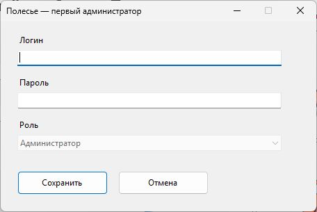

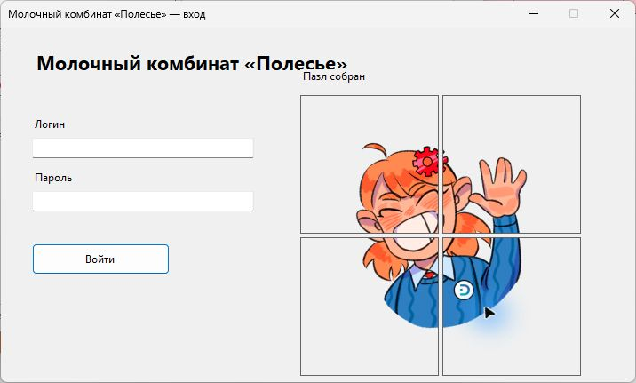

## Проверьте вход, блокировку и редактирование

1. Войдите под пользователем с правильно собранным пазлом. Проверьте название роли и кнопку «Выйти».
2. Снова соберите пазл. Три раза подряд введите неверный пароль пользователя. Затем введите правильный пароль. Снова должно появиться сообщение о блокировке.
3. Войдите под администратором. Найдите пользователя в таблице, нажмите **Снять блокировку**, убедитесь, что число ошибок равно 0. Выйдите и повторите успешный вход пользователя.
4. Проверьте второй сценарий. Введите правильный пароль, оставьте пазл неверным и нажмите «Войти» трижды. Убедитесь, что блокировка сохранилась, и снова снимите её под администратором.
5. Под администратором попробуйте добавить повторный логин пользователя. Программа должна показать предупреждение. Через **Изменить** задайте ему другой логин или пароль и проверьте вход с новыми данными.
6. Измените размер окна администратора. Таблица должна расти вместе с окном. На форме входа проверьте **Tab** от логина к паролю и кнопке.

После входа под обычным пользователем появится отдельное окно с логином и названием роли.

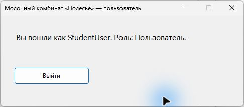

После входа под администратором появится таблица записей, а кнопки позволяют добавить запись, изменить её и снять блокировку.

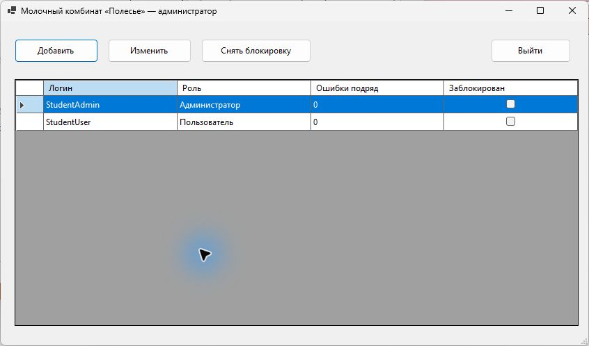

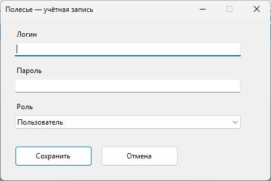

После третьей ошибочной попытки сообщение о блокировке появляется и при правильном пароле с собранным пазлом. В панели администратора у записи видны три ошибки и флажок блокировки.

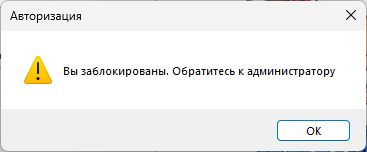
