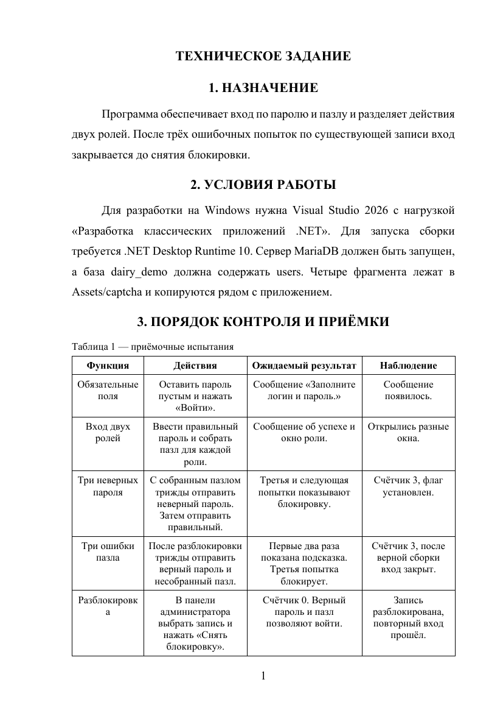

# Подготовьте техническое задание

## Запишите требования

Откройте созданный в Word файл `Техническое задание.docx`. Добавьте заголовки «Назначение», «Условия работы», «Требования к программе» и «Порядок контроля и приёмки».

В назначении укажите, кто входит в систему и для чего администратору управление учётными записями. Для условий работы перечислите Windows, используемую версию .NET, СУБД, наличие таблицы `users` и файлы 1–4 из `Assets/captcha`. Разделите запуск собранного приложения и подготовку среды разработки. Реквизиты к серверу берутся из `db-connection.txt`, учебные логины приложения хранятся в таблице `users`.

Под условиями работы запишите требования из текста задания 4. Для каждого укажите, что видит проверяющий в окне или в таблице. Формулировку «проверка входа» разделите на обязательные поля, пароль, пазл, блокировку и выбор окна по роли. Запрет повторного логина отнесите к действиям администратора.

## Порядок контроля и приёмки

Вставьте таблицу из четырёх столбцов «Проверяемая функция», «Действия», «Ожидаемый результат», «Фактический результат». Превратите требования в шаги, которые другой человек сможет выполнить. Для обычного пользователя начинайте с разблокированной записи и нулевого счётчика.

| Проверяемая функция | Действия | Ожидаемый результат |
|---|---|---|
| Обязательные поля | Оставить одно поле пустым и нажать «Войти» | Сообщение «Заполните логин и пароль.» |
| Вход пользователя | Ввести правильные данные, собрать пазл и нажать «Войти» | Сообщение об успехе и окно пользователя |
| Вход администратора | Проделать те же действия под второй ролью | Открывается таблица и доступны три операции с записями |
| Блокировка по паролю | С собранным пазлом трижды отправить неверный пароль пользователя, затем отправить верный | После третьей ошибки и при повторной попытке появляется «Вы заблокированы. Обратитесь к администратору» |
| Разблокировка | Под администратором выбрать пользователя, снять блокировку, затем повторить правильный вход | Счётчик равен нулю, флажок снят, пользователь входит |
| Блокировка по пазлу | Ввести верный пароль, оставить пазл несобранным и трижды нажать «Войти» | На третьей попытке запись блокируется. С правильным пазлом вход остаётся закрыт до разблокировки |
| Добавление и уникальность | Добавить пользователя, затем повторить сохранение того же логина | Появляется предупреждение, таблица содержит одну запись с этим логином |
| Редактирование | Изменить логин и пароль существующей записи и повторить вход | Старые данные отклоняются, новые работают |

Для своей проверки внесите в последний столбец наблюдаемый результат после каждого прогона. Если ожидание расходится с фактом, сначала сверьте исходное состояние и повторите проверку. В итоговом комплекте оставьте фактическое поведение приложения.

