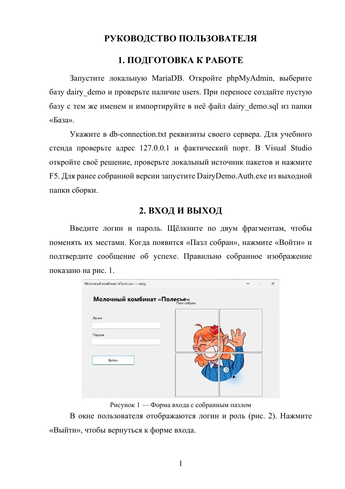

# Подготовьте руководство пользователя

## Опишите подготовку к работе

Откройте в Word файл `Руководство пользователя.docx`. Добавьте заголовки «Подготовка к работе», «Работа с программой», «Действия администратора» и «Сообщения приложения».

В первом разделе укажите, как получить доступ к вашей локальной базе. Запишите название базы, способ запуска сервера, расположение SQL-выгрузки и правило заполнения `db-connection.txt`. Укажите, что реквизиты СУБД берутся из установки или выдаются на площадке. В форму «Войти» вводятся отдельные учётные данные приложения.

Выберите и проверьте вариант, который передаёте. Для исходников опишите, где находится сохранённое решение, как использовать локальные пакеты из этапа 0 и запустить свой проект по **F5**. Если в комплекте сдачи предусмотрена собранная версия, укажите путь к вашему `DairyDemo.Auth.exe`, наличие четырёх PNG и файла настроек рядом с ним, а также требуемый .NET Desktop Runtime. В руководстве опишите, когда открывается диалог первого администратора. Сверьте, что в используемом дампе действительно есть записи, если вы предлагаете войти под ними.

## Работа с программой

Запустите свою программу и запишите действия так, чтобы их мог повторить человек, который её видит впервые.

1. Введите логин и пароль в поля «Логин» и «Пароль».
2. Щёлкните по одному фрагменту, затем по другому, чтобы поменять их местами. Повторяйте, пока подпись над изображением не изменится на «Пазл собран».
3. Нажмите «Войти». После сообщения об успехе нажмите **OK**.
4. В окне пользователя проверьте свой логин и роль. Нажмите «Выйти», чтобы вернуться к экрану входа.

Сделайте свои снимки формы входа после сборки пазла и окна обычного пользователя. Вставьте их через **Вставка → Рисунки → Это устройство**. Подпишите, какое действие или результат показан. Используйте учебную запись и оставьте пароль скрытым.

## Действия администратора

Запишите фактические заголовки столбцов. В приложении из задания 4 это «Логин», «Роль», «Ошибки подряд» и «Заблокирован». Сделайте снимок своей таблицы после добавления одного обычного пользователя.

- **Добавить**. Откройте диалог, заполните логин и пароль, выберите роль, нажмите «Сохранить». Убедитесь, что новая строка появилась в таблице.
- **Изменить**. Выберите строку, нажмите «Изменить» и заполните нужные поля. Чтобы оставить прежний пароль, оставьте поле «Новый пароль (если меняете)» пустым.
- **Снять блокировку**. Выберите заблокированную запись и нажмите кнопку. Сверьте нулевой счётчик и снятый флажок.
- **Выйти**. Вернитесь к экрану входа. Закройте его, чтобы завершить приложение.

## Сообщения приложения

Выпишите фразы прямо из своих окон. Добавьте к каждой фразе следующее действие. Затем попросите проверяющего пройти по вашему тексту либо сами повторите проверку с закрытой Visual Studio и открытым только руководством, запуская приложение указанным способом.

| Сообщение или состояние | Что дальше |
|---|---|
| «Заполните логин и пароль.» | Заполнить оба поля и повторить |
| «Вы ввели неверный логин или пароль. Пожалуйста проверьте ещё раз введенные данные» | Проверить, для какой записи вводится пароль |
| «Соберите изображение для подтверждения» | Собрать пазл до сообщения «Пазл собран» |
| «Вы заблокированы. Обратитесь к администратору» | Попросить администратора снять блокировку |
| «Пользователь с таким логином уже существует.» | Использовать другой логин либо редактировать существующую запись |
| «Подготовка системы» | Сверить параметры `db-connection.txt`, наличие таблицы `users` и четырёх фрагментов в `Assets/captcha` |

## Сохраните комплект

Сохраните все три документа. В рабочей папке откройте с нуля PDF со схемой, SQL-выгрузку базы, итоговый запрос и решение Windows Forms. Сверьте, что вы сохранили схему после последней правки, а выгрузка содержит структуру, импортированные данные и таблицу `users`. Покажите свою версию в порядке задания, от базы и запроса до приложения и документации.

