# Задание 2. Создание базы данных в конструкторе pgAdmin

## Создайте базу dairy_demo

В pgAdmin раскройте локальный сервер из этапа 0. Щёлкните правой кнопкой по **Databases → Create → Database…**. В поле **Database** введите `dairy_demo`, в **Owner** оставьте роль, под которой подключились, и нажмите **Save**. Для своей локальной установки это обычно `postgres`.

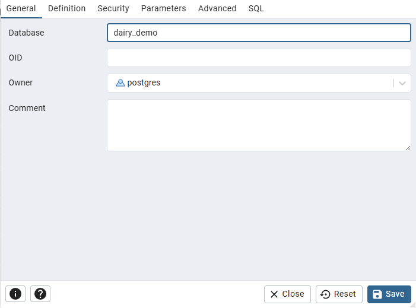

## Создайте схему app в новой базе

Раскройте именно **Databases → dairy_demo**. Сверните открытую служебную базу `postgres`, если она использовалась для ERD Tool. Внутри `dairy_demo` щёлкните правой кнопкой по **Schemas → Create → Schema…**. Укажите **Name = app**, владельца из предыдущего шага и нажмите **Save**. Сверьте путь **Databases → dairy_demo → Schemas → app → Tables**. В эту коллекцию добавите все таблицы.

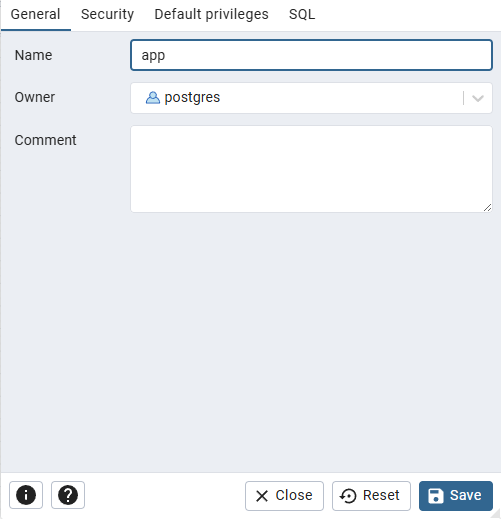

## Освойте конструктор таблицы

Для каждой карточки открывайте **app → Tables → Create → Table…**. В **General** запишите имя и проверьте **Schema = app**. На вкладке **Columns** нажмите кнопку **+** и заполните **Name**, **Data type**, **Not NULL?**, **Primary key?** и **Default** по таблице полей. Если значение по умолчанию обозначено тире, оставьте поле пустым. Для **PK** включите **Primary key?**. Первичный ключ PostgreSQL всегда обязателен.

Для `numeric(12,3)` выберите **Data type = numeric**, введите **Length/Precision = 12** и **Scale = 3**. Для денежной точности `numeric(12,2)` в **Scale** поставьте 2. Тип `bigserial` создаёт числовой идентификатор с автоматической выдачей следующего значения. В свойствах сохранённой колонки он отображается как `bigint` с выражением по умолчанию из последовательности.

Нажмите **Save** и убедитесь, что имя появилось в **app → Tables**. Сначала создайте таблицы со столбцами. Ограничения добавите через свойства, когда таблицы уже есть в базе.

## Создайте таблицу counterparty

Справочник контрагентов из «Заказчики.json». Идентификаторы, ИНН и телефоны хранятся как текст, чтобы сохранить начальные нули и знак `+`.

| Поле | Тип | Обязательное | Default |
|---|---|---|---|
| `id` | `text` | PK | — |
| `name` | `text` | Да | — |
| `inn` | `text` | Нет | — |
| `address` | `text` | Нет | — |
| `phone` | `text` | Нет | — |
| `is_salesman` | `boolean` | Да | `false` |
| `is_buyer` | `boolean` | Да | `false` |


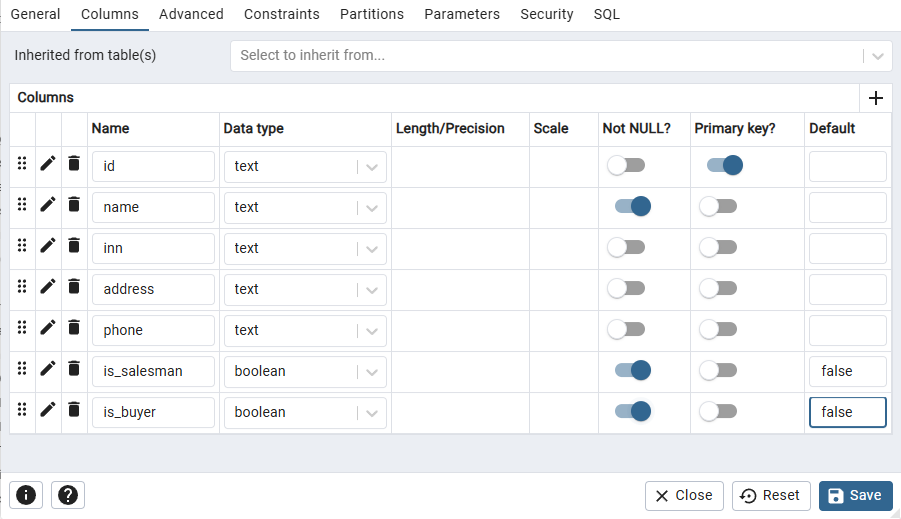

## Создайте таблицу item

Общий справочник материалов и продукции. Код уникален, чтобы одну и ту же позицию можно было найти по исходным документам.

| Поле | Тип | Обязательное | Default |
|---|---|---|---|
| `id` | `bigserial` | PK | — |
| `code` | `text` | Нет | — |
| `name` | `text` | Да | — |
| `item_type` | `text` | Да | — |
| `unit_default` | `text` | Нет | — |


Для шага добавления ограничений подготовьте **Unique** `uq_item_code` на поле `code`.

Для шага добавления ограничений используйте вкладку **Check**. Заполняйте поле **Check** для каждой проверки.

`chk_item_type`. Допускает две категории номенклатуры.

```sql
item_type IN ('product','material')
```

## Создайте таблицу price

Цена относится к позиции справочника. Запись с пустыми датами используется для прайс-листа, в котором срок действия не указан.

| Поле | Тип | Обязательное | Default |
|---|---|---|---|
| `id` | `bigserial` | PK | — |
| `item_id` | `bigint` | Да | — |
| `price` | `numeric(12,2)` | Да | — |
| `effective_from` | `date` | Нет | — |
| `effective_to` | `date` | Нет | — |


Внешние ключи добавьте после создания всех таблиц. Для **On update** используйте **CASCADE**.

| Поле | Ссылка | On delete |
|---|---|---|
| `item_id` | `app.item.id` | RESTRICT |

Для шага добавления ограничений используйте вкладку **Check**. Заполняйте поле **Check** для каждой проверки.

`chk_price_nonnegative`. Цена может быть нулевой или положительной.

```sql
price >= 0
```

`chk_price_dates`. При наличии обеих дат окончание не раньше начала.

```sql
effective_to IS NULL OR effective_from IS NULL OR effective_to >= effective_from
```

## Создайте таблицу specification

Шапка нормы производства. Укажите продукт, количество выпуска и единицу измерения.

| Поле | Тип | Обязательное | Default |
|---|---|---|---|
| `id` | `bigserial` | PK | — |
| `name` | `text` | Да | — |
| `product_item_id` | `bigint` | Да | — |
| `output_qty` | `numeric(12,3)` | Да | `1` |
| `output_unit` | `text` | Нет | — |
| `manufacturer_id` | `text` | Нет | — |


Внешние ключи добавьте после создания всех таблиц. Для **On update** используйте **CASCADE**.

| Поле | Ссылка | On delete |
|---|---|---|
| `manufacturer_id` | `app.counterparty.id` | RESTRICT |
| `product_item_id` | `app.item.id` | RESTRICT |

Для шага добавления ограничений используйте вкладку **Check**. Заполняйте поле **Check** для каждой проверки.

`chk_specification_output`. Количество выпуска положительное.

```sql
output_qty > 0
```

## Создайте таблицу specification_material

Строка спецификации хранит один материал, норму расхода и единицу измерения. Одна и та же пара спецификации и материала встречается только один раз.

| Поле | Тип | Обязательное | Default |
|---|---|---|---|
| `id` | `bigserial` | PK | — |
| `specification_id` | `bigint` | Да | — |
| `material_item_id` | `bigint` | Да | — |
| `qty` | `numeric(12,3)` | Да | — |
| `unit` | `text` | Нет | — |


Внешние ключи добавьте после создания всех таблиц. Для **On update** используйте **CASCADE**.

| Поле | Ссылка | On delete |
|---|---|---|
| `material_item_id` | `app.item.id` | RESTRICT |
| `specification_id` | `app.specification.id` | CASCADE |

Для шага добавления ограничений подготовьте **Unique** `uq_specification_material` на два поля в порядке `specification_id`, `material_item_id`.

Для шага добавления ограничений используйте вкладку **Check**. Заполняйте поле **Check** для каждой проверки.

`chk_specification_material_qty`. Норма расхода указана положительным числом.

```sql
qty > 0
```

## Создайте таблицу production_order

Шапка производственного документа. Поля реквизитов отделены от выпущенной продукции и списанных материалов.

| Поле | Тип | Обязательное | Default |
|---|---|---|---|
| `id` | `bigserial` | PK | — |
| `doc_no` | `text` | Да | — |
| `doc_date` | `date` | Нет | — |
| `manufacturer_id` | `text` | Нет | — |
| `note` | `text` | Нет | — |


Внешние ключи добавьте после создания всех таблиц. Для **On update** используйте **CASCADE**.

| Поле | Ссылка | On delete |
|---|---|---|
| `manufacturer_id` | `app.counterparty.id` | RESTRICT |

## Создайте таблицу production_product_line

Строка выпуска хранит продукт и количество, а внешний ключ связывает её с производственным документом.

| Поле | Тип | Обязательное | Default |
|---|---|---|---|
| `id` | `bigserial` | PK | — |
| `production_order_id` | `bigint` | Да | — |
| `product_item_id` | `bigint` | Да | — |
| `qty` | `numeric(12,3)` | Да | — |
| `unit` | `text` | Нет | — |


Внешние ключи добавьте после создания всех таблиц. Для **On update** используйте **CASCADE**.

| Поле | Ссылка | On delete |
|---|---|---|
| `product_item_id` | `app.item.id` | RESTRICT |
| `production_order_id` | `app.production_order.id` | CASCADE |

Для шага добавления ограничений используйте вкладку **Check**. Заполняйте поле **Check** для каждой проверки.

`chk_production_product_qty`. Количество выпущенной продукции положительное.

```sql
qty > 0
```

## Создайте таблицу production_material_line

Строка списания хранит материал и количество, а внешний ключ связывает её с производственным документом.

| Поле | Тип | Обязательное | Default |
|---|---|---|---|
| `id` | `bigserial` | PK | — |
| `production_order_id` | `bigint` | Да | — |
| `material_item_id` | `bigint` | Да | — |
| `qty` | `numeric(12,3)` | Да | — |
| `unit` | `text` | Нет | — |


Внешние ключи добавьте после создания всех таблиц. Для **On update** используйте **CASCADE**.

| Поле | Ссылка | On delete |
|---|---|---|
| `material_item_id` | `app.item.id` | RESTRICT |
| `production_order_id` | `app.production_order.id` | CASCADE |

Для шага добавления ограничений используйте вкладку **Check**. Заполняйте поле **Check** для каждой проверки.

`chk_production_material_qty`. Количество списанного материала положительное.

```sql
qty > 0
```

## Создайте таблицу customer_order

Шапка заказа покупателя содержит реквизиты, исполнителя, заказчика и сумму документа.

| Поле | Тип | Обязательное | Default |
|---|---|---|---|
| `id` | `bigserial` | PK | — |
| `doc_no` | `text` | Да | — |
| `doc_date` | `date` | Нет | — |
| `executor_id` | `text` | Нет | — |
| `customer_id` | `text` | Нет | — |
| `total_amount` | `numeric(12,2)` | Нет | — |


Внешние ключи добавьте после создания всех таблиц. Для **On update** используйте **CASCADE**.

| Поле | Ссылка | On delete |
|---|---|---|
| `customer_id` | `app.counterparty.id` | RESTRICT |
| `executor_id` | `app.counterparty.id` | RESTRICT |

Для шага добавления ограничений используйте вкладку **Check**. Заполняйте поле **Check** для каждой проверки.

`chk_order_total`. Внесённая сумма заказа неотрицательная.

```sql
total_amount >= 0
```

## Создайте таблицу customer_order_line

Строка заказа хранит продукт, количество и цену сделки. Справочный прайс хранится отдельно.

| Поле | Тип | Обязательное | Default |
|---|---|---|---|
| `id` | `bigserial` | PK | — |
| `customer_order_id` | `bigint` | Да | — |
| `product_item_id` | `bigint` | Да | — |
| `qty` | `numeric(12,3)` | Да | — |
| `unit` | `text` | Нет | — |
| `unit_price` | `numeric(12,2)` | Нет | — |
| `line_amount` | `numeric(12,2)` | Нет | — |


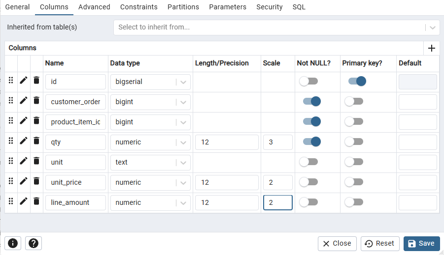

Внешние ключи добавьте после создания всех таблиц. Для **On update** используйте **CASCADE**.

| Поле | Ссылка | On delete |
|---|---|---|
| `customer_order_id` | `app.customer_order.id` | CASCADE |
| `product_item_id` | `app.item.id` | RESTRICT |

Для шага добавления ограничений используйте вкладку **Check**. Заполняйте поле **Check** для каждой проверки.

`chk_customer_line_qty`. Количество товара положительное.

```sql
qty > 0
```

`chk_customer_line_unit_price`. Внесённая цена за единицу неотрицательная.

```sql
unit_price >= 0
```

`chk_customer_line_amount`. Внесённая сумма строки неотрицательная.

```sql
line_amount >= 0
```

## Создайте таблицу cost_calculation

Шапка расчёта себестоимости содержит продукт, объём расчёта и итог.

| Поле | Тип | Обязательное | Default |
|---|---|---|---|
| `id` | `bigserial` | PK | — |
| `calc_date` | `date` | Нет | — |
| `product_item_id` | `bigint` | Да | — |
| `product_qty` | `numeric(12,3)` | Да | `1` |
| `total_cost` | `numeric(12,2)` | Нет | — |


Внешние ключи добавьте после создания всех таблиц. Для **On update** используйте **CASCADE**.

| Поле | Ссылка | On delete |
|---|---|---|
| `product_item_id` | `app.item.id` | RESTRICT |

Для шага добавления ограничений используйте вкладку **Check**. Заполняйте поле **Check** для каждой проверки.

`chk_calculation_qty`. Количество рассчитываемого продукта положительное.

```sql
product_qty > 0
```

`chk_calculation_total`. Внесённый итог калькуляции неотрицательный.

```sql
total_cost >= 0
```

## Создайте таблицу cost_calculation_line

Строка калькуляции хранит материал, норму и значения цены и стоимости именно из документа расчёта.

| Поле | Тип | Обязательное | Default |
|---|---|---|---|
| `id` | `bigserial` | PK | — |
| `cost_calculation_id` | `bigint` | Да | — |
| `material_item_id` | `bigint` | Да | — |
| `qty` | `numeric(12,3)` | Да | — |
| `unit` | `text` | Нет | — |
| `unit_cost` | `numeric(12,2)` | Нет | — |
| `line_cost` | `numeric(12,2)` | Нет | — |


Внешние ключи добавьте после создания всех таблиц. Для **On update** используйте **CASCADE**.

| Поле | Ссылка | On delete |
|---|---|---|
| `cost_calculation_id` | `app.cost_calculation.id` | CASCADE |
| `material_item_id` | `app.item.id` | RESTRICT |

Для шага добавления ограничений используйте вкладку **Check**. Заполняйте поле **Check** для каждой проверки.

`chk_calculation_line_qty`. Количество материала положительное.

```sql
qty > 0
```

`chk_calculation_line_unit_cost`. Внесённая цена материала неотрицательная.

```sql
unit_cost >= 0
```

`chk_calculation_line_cost`. Внесённая стоимость строки неотрицательная.

```sql
line_cost >= 0
```

## Добавьте связи и ограничения через свойства

Щёлкните правой кнопкой по дочерней таблице → **Properties… → Constraints → Foreign Key**. Нажмите **+**. В **General → Name** задайте понятное имя, например `fk_price_item`. Если вложенные вкладки свернулись, нажмите карандаш в строке ограничения.

На вложенной вкладке **Columns** выберите **Local column = item_id**, **References = app.item**, **Referencing = id**. Нажмите **Add**, чтобы строка появилась в списке соответствий. Во вложенной вкладке **Action** укажите **On update = CASCADE** и **On delete** из карточки таблицы. Нажмите **Save**. Повторите для каждого ссылающегося поля.

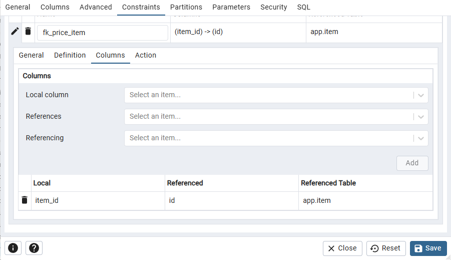

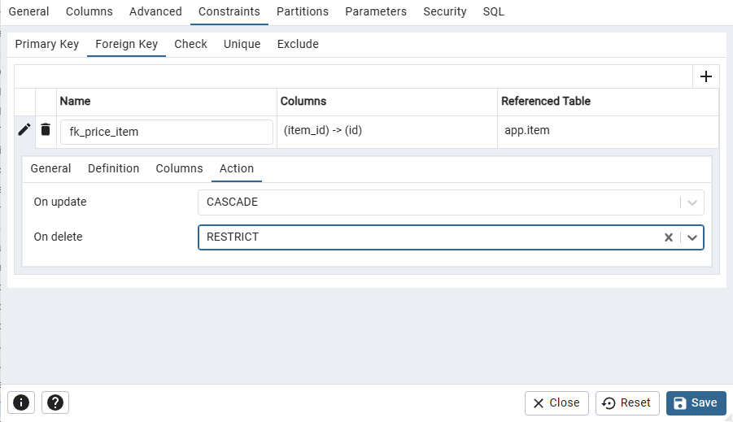

Для проверок используйте **Properties… → Constraints → Check → +**. В строке заполните **Name** и поле **Check**, вставив в него выражение из карточки таблицы. Сохраните и проверьте имя в дереве **Constraints**.

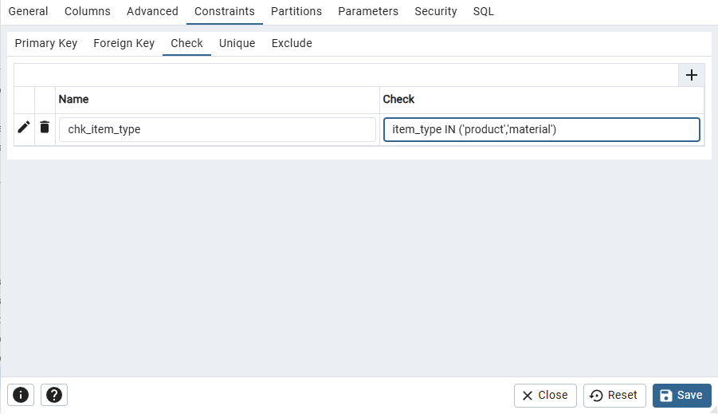

Для уникальности выберите **Constraints → Unique → +**. Во вложенной вкладке **General** задайте имя, во вкладке **Definition → Columns** выберите нужные поля. Для ограничения на пару добавьте оба поля в одну строку настройки. Нажмите **Save**.

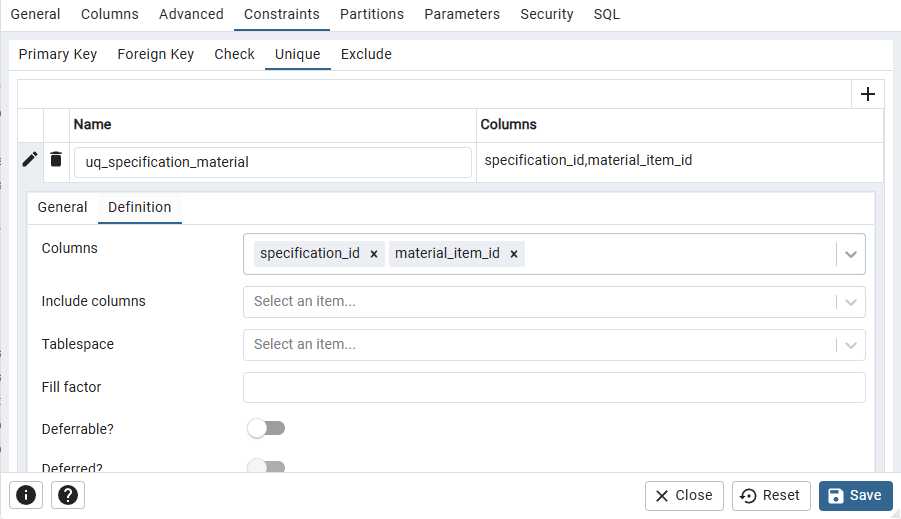

При удалении шапки документа **CASCADE** удаляет строки этого документа. Для справочников **RESTRICT** защищает существующие документы от потери ссылок. Ссылка может быть пустой только там, где в карточке поля разрешён `NULL`.

## Преобразуйте «Заказчики.json» в таблицу Excel

В Excel создайте пустую книгу и откройте **Данные → Получить данные → Из файла → Из JSON**. Выберите исходный `Заказчики.json` из приложения к КОД. В редакторе Power Query появится список из шести элементов **Record**.

1. Нажмите **В таблицу** и подтвердите параметры без разделителя.
2. В заголовке **Column1** нажмите кнопку раскрытия с двумя стрелками. Отметьте все семь полей и снимите флажок **Использовать исходное имя столбца как префикс**. Нажмите **ОК**.
3. Проверьте, что есть `id`, `name`, `inn`, `addres`, `phone`, `salesman`, `buyer`. В первой строке идентификатор должен отображаться как `000000001`.
4. Нажмите **Закрыть и загрузить**. На листе измените заголовки `addres` на `address`, `salesman` на `is_salesman`, `buyer` на `is_buyer`. Сохраните последовательность семи столбцов.
5. В последних двух столбцах замените по шести логических значений. Для **ИСТИНА** введите `1`, для **ЛОЖЬ** — `0`. PostgreSQL принимает эти цифры как логические значения. Проверьте первую и последнюю строки по оригиналу.

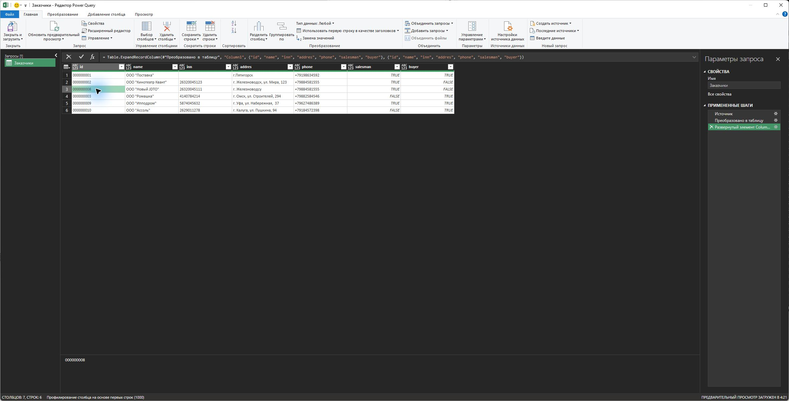

## Сохраните CSV в UTF-8

На листе с данными нажмите **F12**, выберите **CSV UTF-8 (разделитель — запятая)** и сохраните `Заказчики-PostgreSQL.csv`. Если Excel предложит сохранить только текущий лист, подтвердите. После сохранения закройте книгу с CSV.

Откройте CSV в Блокноте. Проверьте строку заголовков, шесть записей и фактический разделитель столбцов. В русских настройках Excel это может быть `;`. Оставьте строку заголовков в файле. Сверьте, что первые нули у `id` и знак `+` у телефона сохранились.

## Импортируйте контрагентов в pgAdmin

В дереве **dairy_demo → Schemas → app → Tables** щёлкните правой кнопкой по **counterparty → Import/Export Data…**.

1. На вкладке **General** выберите **Import**, в **Filename** — подготовленный CSV, **Format = csv**, **Encoding = UTF8**.
2. На вкладке **Options** включите **Header**. В **Delimiter** выберите фактический знак из файла, например `;`. В **Quote** и **Escape** выберите двойную кавычку `"`. Excel удваивает этот знак внутри названий компаний.
3. Оставьте **NULL String** пустым. Пустая ячейка ИНН из CSV будет сохранена как `NULL`.
4. На вкладке **Columns** сверьте последовательность `id`, `name`, `inn`, `address`, `phone`, `is_salesman`, `is_buyer`. Нажмите **OK**.
5. После сообщения **Process completed** откройте **counterparty → View/Edit Data → All Rows**. Под таблицей должно стоять **Total rows: 6**. Сверьте название, адрес, телефон и оба признака у одной записи и проверьте, что нули у идентификаторов остались.

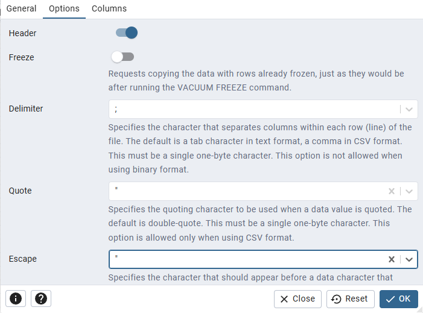

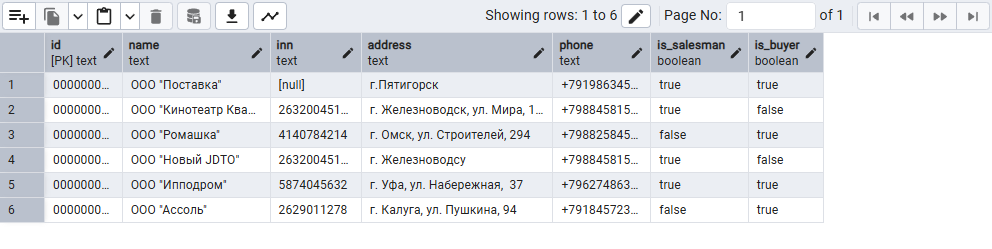

## Выгрузите и восстановите свою базу

Щёлкните правой кнопкой по **dairy_demo → Backup…**. На вкладке **General** выберите имя `dairy_demo.sql` в своей рабочей папке и **Format = Plain**. На вкладке **Data Options** оставьте **Only data** и **Only schemas** выключенными. В группе **Do not save** включите **Owner** и **Privileges**, чтобы перенести структуру и данные под другой локальной ролью. Нажмите **Backup**. Дождитесь завершения процесса и убедитесь, что SQL-файл появился.

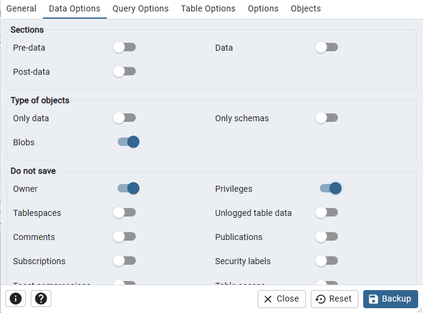

Для проверки через **Databases → Create → Database…** создайте отдельную пустую базу `dairy_demo_pg_check`. Щёлкните по ней правой кнопкой → **Restore…**, укажите **Format = Plain** и сохранённый SQL-файл. Нажмите **Restore** и дождитесь завершения. Раскройте **Schemas → app → Tables**. В копии должно быть 12 таблиц. Откройте `counterparty` через **View/Edit Data → All Rows** и проверьте все шесть записей. В следующих заданиях продолжайте работать в `dairy_demo`.
