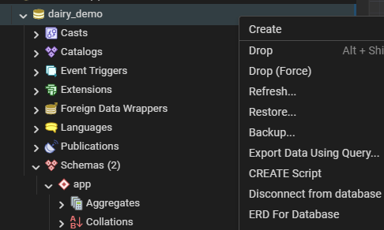
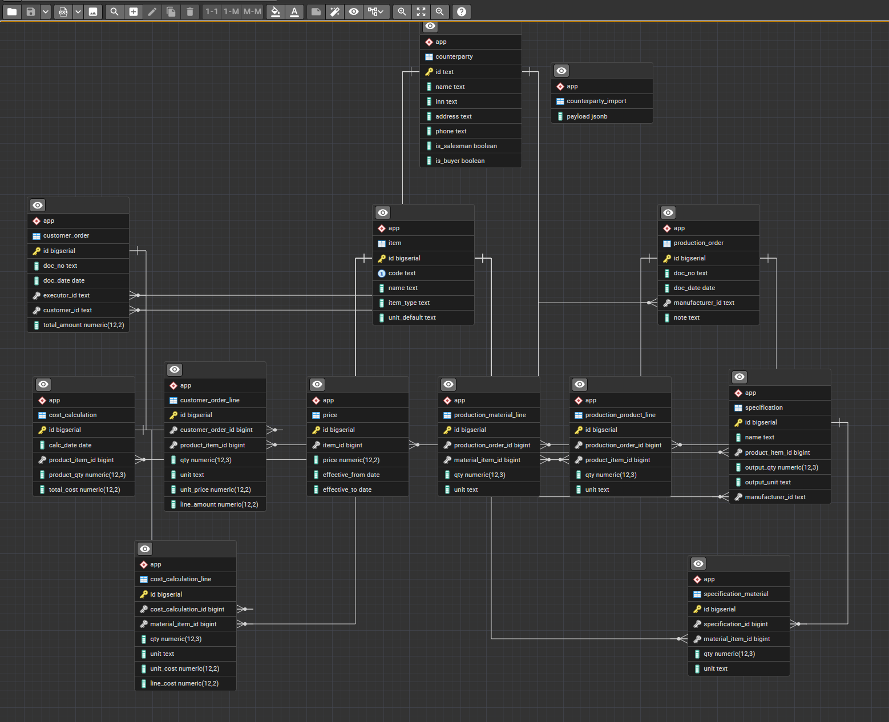
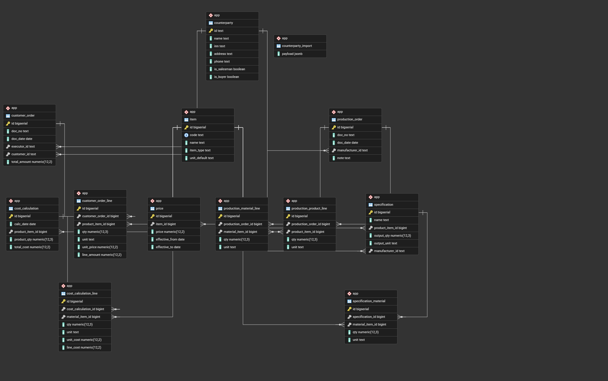

# Модуль 2. Разработка базы данных по ER-диаграмме (PostgreSQL через SQL)

**Цель:** создать БД и таблицы по ER, настроить PK/FK/ограничения, затем импортировать `Заказчики.json`.

---

## 0. Важно перед стартом

* Везде ниже есть два варианта выполнения:

  * **Вариант A — Конструктор (pgAdmin GUI)**
  * **Вариант B — SQL-запрос (DDL/DML)**

* Рекомендуемая структура: схема `app` (чтобы отделить от `public`).

---

## 1. Создание базы данных

### Создание БД через SQL

```sql
CREATE DATABASE dairy_demo;
```

Подключение:

* pgAdmin: выбрать БД в дереве
* psql: `\c dairy_demo`

---

## 2. Создание схемы (namespace) `app`

```sql
CREATE SCHEMA IF NOT EXISTS app;
SET search_path TO app, public;
```

---

## 3. Создание таблиц по ER-диаграмме (каждая — GUI или SQL)

> Ниже перечислены основные сущности. Для каждой — 2 способа.

---

### 3.1. COUNTERPARTY (Контрагент)

 

```sql
CREATE TABLE IF NOT EXISTS app.counterparty (
    id            TEXT PRIMARY KEY,
    name          TEXT NOT NULL,
    inn           TEXT,
    address       TEXT,
    phone         TEXT,
    is_salesman   BOOLEAN NOT NULL DEFAULT FALSE,
    is_buyer      BOOLEAN NOT NULL DEFAULT FALSE
);
```

---

### 3.2. ITEM (Номенклатура)

 
```sql
CREATE TABLE IF NOT EXISTS app.item (
    id           BIGSERIAL PRIMARY KEY,
    code         TEXT UNIQUE,
    name         TEXT NOT NULL,
    item_type    TEXT NOT NULL CHECK (item_type IN ('product','material')),
    unit_default TEXT
);
```

---

### 3.3. PRICE (Прайс-лист)


```sql
CREATE TABLE IF NOT EXISTS app.price (
    id             BIGSERIAL PRIMARY KEY,
    item_id        BIGINT NOT NULL REFERENCES app.item(id) ON UPDATE CASCADE ON DELETE RESTRICT,
    price          NUMERIC(12,2) NOT NULL CHECK (price >= 0),
    effective_from DATE,
    effective_to   DATE,
    CHECK (effective_to IS NULL OR effective_from IS NULL OR effective_to >= effective_from)
);

CREATE INDEX IF NOT EXISTS idx_price_item ON app.price(item_id);
```

---

### 3.4. SPECIFICATION и SPECIFICATION_MATERIAL

#### SPECIFICATION
  

```sql
CREATE TABLE IF NOT EXISTS app.specification (
    id              BIGSERIAL PRIMARY KEY,
    name            TEXT NOT NULL,
    product_item_id BIGINT NOT NULL REFERENCES app.item(id) ON UPDATE CASCADE ON DELETE RESTRICT,
    output_qty      NUMERIC(12,3) NOT NULL DEFAULT 1 CHECK (output_qty > 0),
    output_unit     TEXT,
    manufacturer_id TEXT REFERENCES app.counterparty(id) ON UPDATE CASCADE ON DELETE RESTRICT
);
```

#### SPECIFICATION_MATERIAL


```sql
CREATE TABLE IF NOT EXISTS app.specification_material (
    id               BIGSERIAL PRIMARY KEY,
    specification_id BIGINT NOT NULL REFERENCES app.specification(id) ON UPDATE CASCADE ON DELETE CASCADE,
    material_item_id BIGINT NOT NULL REFERENCES app.item(id) ON UPDATE CASCADE ON DELETE RESTRICT,
    qty              NUMERIC(12,3) NOT NULL CHECK (qty > 0),
    unit             TEXT,
    CONSTRAINT uq_spec_material UNIQUE (specification_id, material_item_id)
);
```

---

### 3.5. PRODUCTION_ORDER, PRODUCTION_PRODUCT_LINE, PRODUCTION_MATERIAL_LINE


```sql
CREATE TABLE IF NOT EXISTS app.production_order (
    id              BIGSERIAL PRIMARY KEY,
    doc_no          TEXT NOT NULL,
    doc_date        DATE,
    manufacturer_id TEXT REFERENCES app.counterparty(id) ON UPDATE CASCADE ON DELETE RESTRICT,
    note            TEXT
);

CREATE TABLE IF NOT EXISTS app.production_product_line (
    id                  BIGSERIAL PRIMARY KEY,
    production_order_id BIGINT NOT NULL REFERENCES app.production_order(id) ON UPDATE CASCADE ON DELETE CASCADE,
    product_item_id     BIGINT NOT NULL REFERENCES app.item(id) ON UPDATE CASCADE ON DELETE RESTRICT,
    qty                 NUMERIC(12,3) NOT NULL CHECK (qty > 0),
    unit                TEXT
);

CREATE TABLE IF NOT EXISTS app.production_material_line (
    id                  BIGSERIAL PRIMARY KEY,
    production_order_id BIGINT NOT NULL REFERENCES app.production_order(id) ON UPDATE CASCADE ON DELETE CASCADE,
    material_item_id    BIGINT NOT NULL REFERENCES app.item(id) ON UPDATE CASCADE ON DELETE RESTRICT,
    qty                 NUMERIC(12,3) NOT NULL CHECK (qty > 0),
    unit                TEXT
);
```

---

### 3.6. CUSTOMER_ORDER и CUSTOMER_ORDER_LINE


```sql
CREATE TABLE IF NOT EXISTS app.customer_order (
    id           BIGSERIAL PRIMARY KEY,
    doc_no       TEXT NOT NULL,
    doc_date     DATE,
    executor_id  TEXT REFERENCES app.counterparty(id) ON UPDATE CASCADE ON DELETE RESTRICT,
    customer_id  TEXT REFERENCES app.counterparty(id) ON UPDATE CASCADE ON DELETE RESTRICT,
    total_amount NUMERIC(12,2) CHECK (total_amount >= 0)
);

CREATE TABLE IF NOT EXISTS app.customer_order_line (
    id                BIGSERIAL PRIMARY KEY,
    customer_order_id BIGINT NOT NULL REFERENCES app.customer_order(id) ON UPDATE CASCADE ON DELETE CASCADE,
    product_item_id   BIGINT NOT NULL REFERENCES app.item(id) ON UPDATE CASCADE ON DELETE RESTRICT,
    qty               NUMERIC(12,3) NOT NULL CHECK (qty > 0),
    unit              TEXT,
    unit_price        NUMERIC(12,2) CHECK (unit_price >= 0),
    line_amount       NUMERIC(12,2) CHECK (line_amount >= 0)
);
```

---

### 3.7. COST_CALCULATION и COST_CALCULATION_LINE
 

```sql
CREATE TABLE IF NOT EXISTS app.cost_calculation (
    id             BIGSERIAL PRIMARY KEY,
    calc_date      DATE,
    product_item_id BIGINT NOT NULL REFERENCES app.item(id) ON UPDATE CASCADE ON DELETE RESTRICT,
    product_qty    NUMERIC(12,3) NOT NULL DEFAULT 1 CHECK (product_qty > 0),
    total_cost     NUMERIC(12,2) CHECK (total_cost >= 0)
);

CREATE TABLE IF NOT EXISTS app.cost_calculation_line (
    id                  BIGSERIAL PRIMARY KEY,
    cost_calculation_id BIGINT NOT NULL REFERENCES app.cost_calculation(id) ON UPDATE CASCADE ON DELETE CASCADE,
    material_item_id    BIGINT NOT NULL REFERENCES app.item(id) ON UPDATE CASCADE ON DELETE RESTRICT,
    qty                 NUMERIC(12,3) NOT NULL CHECK (qty > 0),
    unit                TEXT,
    unit_cost           NUMERIC(12,2) CHECK (unit_cost >= 0),
    line_cost           NUMERIC(12,2) CHECK (line_cost >= 0)
);
```

---

## 4. Импорт `Заказчики.json` (GUI или SQL)


#### Шаг 1. Staging-таблица

```sql
CREATE TABLE IF NOT EXISTS app.counterparty_import (
    payload JSONB NOT NULL
);
```

#### Шаг 2. Загрузка файла (psql)


##### Ключевой момент (важно)

```text
\copy — это НЕ SQL-команда
```

* `\copy` — это **psql-команда**
* **Query Tool** принимает **только SQL**
* **PSQL Tool** принимает `\copy`

Отсюда и ошибка:

```
syntax error at or near "\"
```

PostgreSQL просто не знает, что такое `\copy`.

---

##### Правильный вариант №1 (РЕКОМЕНДУЕТСЯ): PSQL Tool

### Как сделать правильно

1. В pgAdmin откройте меню:

```
Tools → PSQL Tool
```

⚠️ **НЕ Query Tool**

2. Дождитесь приглашения вида:

```
postgres=# 
```

или

```
dairy_demo=# 
```

3. Выполните команду **без изменений**:

```sql
\copy app.counterparty_import(payload)
FROM 'C:/Demo/Заказчики.json'
WITH (FORMAT text);
```

### Почему именно так

* В PSQL Tool:

   * `\copy` — допустима
   * путь с `/` — самый надёжный вариант
   * JSON будет загружен **как есть**, без искажений
   * `C:/Demo/Заказчики.json` — меняется на ваш путь файла

#### Шаг 3. Распаковка массива JSON в таблицу `counterparty`

```sql
INSERT INTO app.counterparty (id, name, inn, address, phone, is_salesman, is_buyer)
SELECT
    e->>'id' AS id,
    e->>'name' AS name,
    NULLIF(e->>'inn','') AS inn,
    NULLIF(COALESCE(e->>'addres', e->>'address'), '') AS address,
    NULLIF(e->>'phone','') AS phone,
    COALESCE((e->>'salesman')::BOOLEAN, FALSE) AS is_salesman,
    COALESCE((e->>'buyer')::BOOLEAN, FALSE) AS is_buyer
FROM (
    SELECT jsonb_array_elements(payload) AS e
    FROM app.counterparty_import
) t
ON CONFLICT (id) DO UPDATE
SET
    name        = EXCLUDED.name,
    inn         = EXCLUDED.inn,
    address     = EXCLUDED.address,
    phone       = EXCLUDED.phone,
    is_salesman = EXCLUDED.is_salesman,
    is_buyer    = EXCLUDED.is_buyer;
```

#### Шаг 4. Проверка

```sql
SELECT COUNT(*) FROM app.counterparty;
SELECT * FROM app.counterparty ORDER BY id LIMIT 10;
```

---


## 5. Проверка своей базы данных

Для проверки свой БД после создания таблиц создайте ER-диагамму средствами Postgress для сравнения, что вы ничего не забыли. 

### 5.1. Выбрать БД

Нажимите на своей БД правой клавишей мыши. 

   

   /// caption
   Рисунок 1 – Проверка своей базы данных
   ///

### 5.2. Создание ER-диаграммы


   

   /// caption
   Рисунок 2 – Создание ER-диаграммы
   ///

### 5.3. Сохранение диаграммы

Диаграмму можно сохранить рядом с вашим ER, которые вы создали в начале экзамена с именем expodt_db.

   

   /// caption
   Рисунок 3 – Пример сохраненной диаграммы
   ///

## 6. Скачать пример готовой базы данных

- `dairy_demo.sql`

[Скачать текстовый SQL-дамп](../assets/files/dairy_demo.sql)

В pgAdmin создайте отдельную пустую базу. Выберите её в дереве, откройте **Query Tool** → **Open File**, выберите скачанный файл и нажмите **Execute**. В схеме `app` появятся таблицы и данные, в `app.counterparty` — шесть контрагентов.
 
