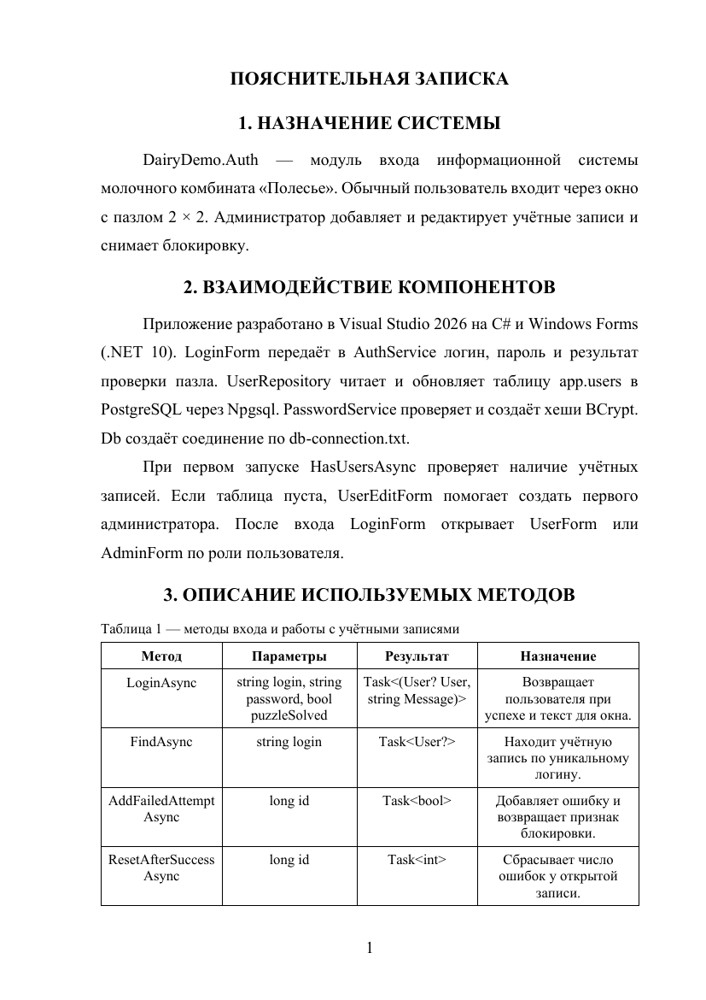

# Подготовьте пояснительную записку

## Создайте файлы документации

Откройте Word → **Файл → Создать → Новый документ**. Нажмите **F12**, выберите рабочую папку «Документы» и сохраните файл как `Пояснительная записка.docx`. Так же создайте `Техническое задание.docx` и `Руководство пользователя.docx`. Эти три файла помогают разделить описание реализации, требования и действия пользователя. Если на площадке выдали форму сдачи, перенесите в неё нужные разделы.

В пояснительной записке добавьте заголовки «Назначение системы», «Взаимодействие компонентов» и «Описание используемых классов и методов». Для заголовков выберите стиль **Главная → Стили → Заголовок 1**. Пишите о своей работающей версии из задания 4.

## Функциональное назначение

Откройте собственную форму входа. Запишите, что она принимает логин и пароль, проверяет сборку пазла и передаёт пользователя в окно его роли. Затем войдите под обеими ролями и перечислите доступные действия.

- Пользователь видит свой логин и роль, нажимает «Выйти» и возвращается к форме входа.
- Администратор просматривает записи, добавляет и редактирует их, снимает блокировку.
- Счётчик увеличивается при неверном пароле или несобранном пазле для существующей незаблокированной записи. Третья ошибочная попытка блокирует запись. Успешный вход и снятие блокировки обнуляют счётчик.

Сверьте каждое утверждение с результатом запуска. Укажите, что приложение создано на C# с Windows Forms и использует таблицу `app.users` в PostgreSQL, к которой подключается через Npgsql. Запишите версии, которые вы действительно использовали.

## Взаимодействие компонентов

Посмотрите структуру проекта в **Обозревателе решений**. Опишите, как данные проходят через формы, службы и базу.

| Откуда | Что передаётся дальше | Куда |
|---|---|---|
| `LoginForm` | Логин, введённый пароль и признак сборки пазла | `AuthService` |
| `AuthService` | Логин для поиска или идентификатор для обновления попыток | `UserRepository` |
| `UserRepository` | Параметры запроса, прочитанные и изменённые записи | Таблица `app.users` |
| `AuthService` | Найденная запись при успешном входе и текст сообщения | `LoginForm`, которая выбирает окно по роли |
| `AdminForm` | Идентификатор записи, логин, роль и хеш при смене пароля | `UserRepository` |

В строке с сохранением объясните, где пароль превращается в хеш. В `UserEditForm` пароль вводится в замаскированное поле, `PasswordService` формирует хеш, `UserRepository` сохраняет хеш. Параметры соединения читает `Db` из `db-connection.txt`.

## Описание используемых классов и методов

В Word выберите **Вставка → Таблица**. Сделайте четыре столбца «Метод», «Параметры», «Результат», «Что делает». Откройте исходник нужного класса в Visual Studio и выпишите объявление метода, включая имена и типы параметров. У частных обработчиков форм берите имена из файлов форм без `.Designer`.

На примере `AuthService.LoginAsync` разберите `string login`, `string password` и `bool puzzleSolved`. В первом параметре передаётся логин из `tbLogin`, во втором — введённый пароль, в третьем — результат сравнения порядка фрагментов. После `await` возвращается пара `(User? User, string Message)`. Первый элемент содержит запись при успешном входе или `null` при отказе. Второй элемент показывает, какое сообщение увидит пользователь. Запишите результат в отдельной ячейке.

Дополните таблицу по своим исходникам. Для проекта, собранного по заданию 4, проверьте такие строки:

| Метод | Параметры | Результат | Что делает |
|---|---|---|---|
| `Db.CreateConnection` | Нет | `NpgsqlConnection` | Читает строку подключения и создаёт объект соединения |
| `UserRepository.FindAsync` | `string login` | `Task<User?>` | Ищет запись по уникальному логину |
| `UserRepository.ListAsync` | Нет | `Task<List<User>>` | Возвращает записи для панели администратора |
| `UserRepository.HasUsersAsync` | Нет | `Task<bool>` | Проверяет наличие хотя бы одной записи для первого запуска |
| `PasswordService.Hash` | `string password` | `string` | Формирует хеш BCrypt для сохранения |
| `PasswordService.Verify` | `string password`, `string hash` | `bool` | Сравнивает введённый пароль с сохранённым хешем |
| `UserRepository.AddFailedAttemptAsync` | `long id` | `Task<bool>` | Фиксирует ошибку и возвращает состояние блокировки |
| `UserRepository.ResetAfterSuccessAsync` | `long id` | `Task<int>` | Обнуляет счётчик у незаблокированной записи |
| `UserRepository.SaveAsync` | `long? id`, `string login`, `string role`, `string? hash` | `Task<int>` | При `id = null` добавляет запись, при переданном `id` изменяет её. У существующей записи `hash = null` сохраняет прежний пароль |
| `UserRepository.UnlockAsync` | `long id` | `Task<int>` | Снимает флаг и сбрасывает счётчик |

Для операций, возвращающих `Task<int>`, подпишите, что после ожидания возвращается число строк, сообщённое драйвером. Проверьте отступы в ячейках и убедитесь, что имена методов читаются при просмотре документа в режиме разметки страницы.

